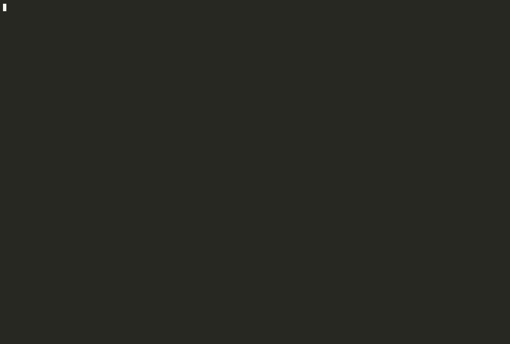
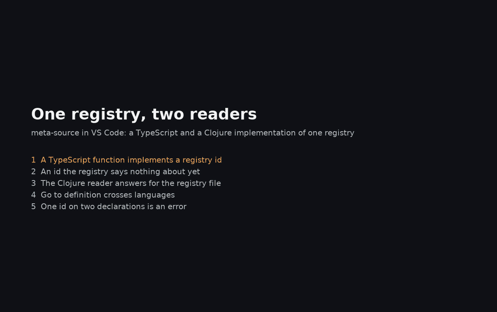

# meta-source

**clj-kondo for system specifications.**

clj-kondo checks your code. meta-source checks what your code *declares*:
your integrant system, your specs and malli schemas, your Pathom resolvers,
your re-frame events and subscriptions.
It reads them where they are, together, without running your app, and tells
you where they disagree.

```
$ meta-source check --brief
warning resources/system.edn:8             no config defines :shop/metrics
info    src/shop/handlers.clj:7            :order/discount is used here but is not in :fn/place-order's contract
info    src/shop/spec.clj:12               :user/emial has no spec of its own
info    src/shop/resolvers.clj:15          nothing produces :order/lines
info    src/shop/resolvers.clj:18          nothing produces :user/loyalty-tier
```

- Is every `#ig/ref` in your system actually configured? Find out before
  `ig/init` does.
- Did someone typo a key inside an `s/keys`? spec won't tell you; it accepts
  keys with no spec.
- Does every `dispatch` reach a registered event? re-frame only logs it,
  when it runs.
- Which resolvers and functions read or return `:user/email`, and is it PII?
- What depends on `:shop/db`?
- Does this function read keys its contract doesn't declare?

No migration, and nothing to annotate to get started: one `meta-source.edn`
and a babashka command. In Emacs, the findings are underlined where they are.

> **Experimental.** The file format, the pack interface and the CLI may change.

## Adopting it

The [meta-source-packs README](https://github.com/semantic-namespace/meta-source-packs#readme) shows it adopted, one pack
at a time, in Emacs: on an app with an integrant system, specs and Pathom
resolvers, and on a re-frame app. What it costs, by `git status`: a
`meta-source.edn` and a `registry/` directory.

## Your own rules



A shop meta-source already reads gets its team's rules, in a `rules/` file:

1. **Whatever reads PII is audited**: the resolver reading `:user/email`
   is marked where it is defined.
2. **`{:shop.resolvers/user-by-email {:audit/logged true}}`** in EDN: the mark
   goes. The rule sees the EDN fact and the Pathom resolver as one entity.
3. **What `init-key` starts, `halt-key!` stops**: the two components with an
   `init-key` and no `halt-key!`, marked at their `defmethod`s.

## Install

```sh
bbin install io.github.semantic-namespace/meta-source
```

Needs [babashka](https://babashka.org), [bbin](https://github.com/babashka/bbin),
and Java the first time, to resolve dependencies. clj-kondo comes as a pod.

Then, at your project's root:

```clojure
;; meta-source.edn
{;; the packs for Clojure libraries are a library: meta-source puts it on
 ;; the classpath and finds its packs there
 :deps {io.github.semantic-namespace/meta-source-packs
        {:git/url "https://github.com/semantic-namespace/meta-source-packs" :git/sha "<sha>"}}
 :packs {:integrant {:configs ["resources"]}
         :spec {}
         :pathom {}}}
```

meta-source alone reads your EDN files, the vars your meta key links, and
your namespaces (the `:namespaces` pack); a pack of your own is one map,
enabled by its symbol.

```sh
meta-source check --brief      # where your declarations disagree
meta-source check --brief --fail-on error   # in CI: exit 1 on an error
meta-source uses :app/db       # what refers to it, and what calls its var
meta-source data :user/email   # a data key's shape, producers and consumers
```

Add `.meta-source/` (its cache) to `.gitignore`. For Emacs:

```elisp
;; emacs/meta-source.el, anywhere on your load path
(require 'meta-source)
(meta-source-setup)
```

Eldoc describes the keyword at point, `M-.` goes to each place that declares
it, `M-?` lists what uses it, `C-c .` opens the describe buffer, and Flymake
underlines what `check` finds.

## JavaScript and TypeScript

EXPERIMENTAL. [meta-source-js](https://github.com/semantic-namespace/meta-source-js#readme) reads JavaScript and
TypeScript code against the same registry, `meta-source.edn` and questions.
The [VS Code extension](vscode) runs both readers:



## How it relates to clj-kondo and clojure-lsp

They know your code: namespaces, vars, calls, arities. meta-source knows
what your keywords *mean* in the libraries that declare them: that `:shop/db`
is an integrant component other components refer to, that `:user/email` is a
key a spec shapes and a resolver returns. The registries are already there, each
library's own; nothing answers the questions that cross them.

meta-source builds on clj-kondo: it runs clj-kondo's analysis to find the
forms each library uses to declare things, then reads those forms as data.
That analysis uses your project's `.clj-kondo` config, as your editor's
clj-kondo does: a macro you've taught clj-kondo (`:lint-as`, a hook, a
library's imported config) is read as what it defines.

## How it's built

meta-source builds one index of the ids your code shares with its
registries. It reads clj-kondo's analysis of your code, with each library's
pack reading that library's forms as data, plus your EDN files and any
snapshots of the running system, and merges what they say per id. The
CLI, `serve` (and the editors through it) and CI all ask that one index.
[docs/architecture.md](docs/architecture.md) explains the pieces and how
they fit together: the pipeline, the merge, the questions and checks, the
two readers, and where each piece lives.

## What it reads

- **Packs** read one library's registry each. meta-source has one,
  **namespaces**: your own namespaces as entities, by a naming convention you
  state, and what each requires, so rules can say which may require which.
  The packs for aero, integrant, clojure.spec and malli, Pathom, re-frame,
  reitit, Datascript, tilakone, Overarch and grain are
  [meta-source-packs](https://github.com/semantic-namespace/meta-source-packs#readme). A pack of your own is one map:
  [docs/packs.md](docs/packs.md).
- **Facts merge per keyword.** A file says things about an id; it doesn't
  own it. An EDN file can add `:data/privacy :pii` to a key a spec defines.
  Two sources giving one key different values is a conflict, named with both
  places, never last-write-wins.
- **Nothing is evaluated.** The Clojure reader and clj-kondo, in babashka.
  Your code is never loaded. (clj-kondo runs your `.clj-kondo` hooks, if you
  have any, in its own interpreter, as it does in your editor.) An option written as code is reported as not
  read rather than guessed.
- **What runs can be compared with what is written.** A running Pathom
  environment can write a snapshot; meta-source fills in what the code
  doesn't say and reports where the two disagree.
- **Your own rules, as data**, over every source at once:
  `{:when {:= {:data/privacy :pii}} :require [{:consumers {:all {:has :audit/logged}}}]}`
  reports each PII key read by something not audited, and where.
  [docs/reference.md](docs/reference.md#your-own-rules)
- **Plain functions** with an `s/fdef` or a malli `m/=>` are checked against
  it: code reading a key the contract's specs don't list is reported. Others
  opt in with one meta key and a contract in your own vocabulary.
  [docs/reference.md](docs/reference.md)

## Why it's built this way

Decomplecting Clojure meta:

- **identity from place**: an id is a qualified keyword, wherever it is
  written;
- **facts from owners**: files contribute facts about an id; none of them
  owns it;
- **what the code says from what the process registered**: a snapshot of
  the running system, compared with what was read from the files;
- **reading from evaluating**: declarations are data, so they can be read
  without running anything.

Each library stays the authority on what it declares. meta-source is the
cross-reference, and it keeps the cross-reference true.

## Status

Working today: the index, `check` and the queries, rules, the Emacs package,
a project's own packs, and the [packs](https://github.com/semantic-namespace/meta-source-packs#readme) for Clojure
libraries. New and experimental: the [JavaScript/TypeScript reader](https://github.com/semantic-namespace/meta-source-js#readme)
and the VS Code extension. How often each check is right on real apps is
measured in [meta-source-corpus](https://github.com/semantic-namespace/meta-source-corpus#readme).

## More

- [docs/reference.md](docs/reference.md): every command, what `check`
  finds, EDN facts and the meta key, the Emacs package
- [docs/architecture.md](docs/architecture.md): how it's built, and how the
  pieces fit together
- [docs/packs.md](docs/packs.md): writing a pack, and the namespaces pack
- [meta-source-packs](https://github.com/semantic-namespace/meta-source-packs#readme): the packs for Clojure libraries,
  and findings on [sdiff](https://github.com/semantic-namespace/diff)'s
  review page
- [meta-source-js](https://github.com/semantic-namespace/meta-source-js#readme): the JavaScript and TypeScript reader
- [meta-source-corpus](https://github.com/semantic-namespace/meta-source-corpus#readme): how often each check is right,
  on real apps

```sh
bb smoke                   # the core's checks, on test/fixtures/core with no library pack
bb emacs-smoke             # meta-source.el against a real meta-source serve
bb conformance             # the answers every reader must give (conformance/)
bb jvm-check               # the core loads on the JVM, and builds babashka's index
```

meta-source started as `atlas.source` in
[atlas](https://github.com/semantic-namespace/atlas).

## License

MIT
