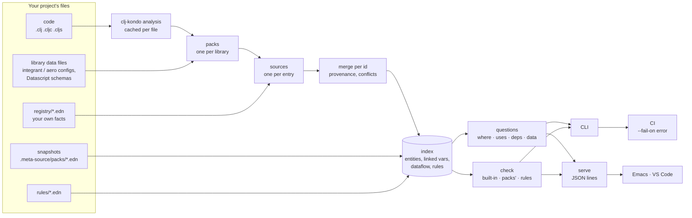

# meta-source

**clj-kondo for system specifications.**

clj-kondo checks your code. meta-source checks what your code *declares*:
your integrant system, your specs and malli schemas, your Pathom resolvers,
your re-frame events and subscriptions.
It reads them where they are, together, without running your app, and tells
you where they disagree.

```
$ meta-source check --brief
warning resources/system.edn:8             no config defines :shop/metrics
info    src/shop/handlers.clj:7            :order/discount is used here but is not in :fn/place-order's contract
info    src/shop/spec.clj:12               :user/emial has no spec of its own
info    src/shop/resolvers.clj:15          nothing produces :order/lines
info    src/shop/resolvers.clj:18          nothing produces :user/loyalty-tier
```

- Is every `#ig/ref` in your system actually configured? Find out before
  `ig/init` does.
- Did someone typo a key inside an `s/keys`? spec won't tell you; it accepts
  keys with no spec.
- Does every `dispatch` reach a registered event? re-frame only logs it,
  when it runs.
- Which resolvers and functions read or return `:user/email`, and is it PII?
- What depends on `:shop/db`?
- Does this function read keys its contract doesn't declare?

No migration, and nothing to annotate to get started: one `meta-source.edn`
and a babashka command. In Emacs, the findings are underlined where they are.

> **Experimental.** The file format, the pack interface and the CLI may change.

## Adopting it in an existing app


An app with an integrant system, specs and Pathom resolvers, open in Emacs,
adopting meta-source one line at a time (every edit is typed in the
recording):

1. **`{:packs {:integrant {:configs ["resources"]}}}`**: a ref to a
   component no config defines, underlined in `system.edn`.
2. **`:pathom {}`**: resolver inputs nothing produces.
3. **`:spec {}`, and one fact in EDN, `{:user/email {:data/privacy :pii}}`**:
   `C-c .` on `:user/email` puts three sources together:

   ```
   :user/email    data key

   spec       (s/and string? #(re-find #"@" %1))    src/shop/spec.clj:5
   :data/privacy  :pii
   member of
     :shop.spec/user    src/shop/spec.clj:12

   produced by
     :shop.resolvers/user-by-id    src/shop/resolvers.clj:11

   consumed by
     :shop.resolvers/user-by-email    src/shop/resolvers.clj:4
   ```
4. **Nothing**: the `s/fdef` the app already has for `place-order` is its
   contract, so the code reading `:order/discount`, which the fdef doesn't
   declare, is underlined. A function with no fdef can opt in with a meta
   key and a contract in EDN.

What it cost, by `git status`: a `meta-source.edn` and a `registry/`
directory. No line of code changed.

### On a re-frame app


1. **`{:packs {:re-frame {:provided [:http-xhrio]}}}`**: an `:on-failure`
   callback to an event nothing registers, and a subscription with a typo.
   re-frame would only log them, when they run.
2. **`C-c .` on `::events/checkout`**: where it is registered and
   dispatched from, what it dispatches, the effects it returns, the keys it
   writes.
3. **`:spec {}` and `{:user/email {:data/privacy :pii}}`**: `C-c .` on
   `:user/email` gives its spec, that it is PII, the event that writes it and
   the subscription that reads it.
4. **The typo fixed**: the underline goes.

### Your own rules


A shop meta-source already reads gets its team's rules, in a `rules/` file:

1. **Whatever reads PII is audited**: the resolver reading `:user/email`
   is marked where it is defined.
2. **`{:shop.resolvers/user-by-email {:audit/logged true}}`** in EDN: the mark
   goes. The rule sees the EDN fact and the Pathom resolver as one entity.
3. **What `init-key` starts, `halt-key!` stops**: the two components with an
   `init-key` and no `halt-key!`, marked at their `defmethod`s.

## Install

```sh
bbin install io.github.semantic-namespace/meta-source
```

Needs [babashka](https://babashka.org), [bbin](https://github.com/babashka/bbin),
and Java the first time, to resolve dependencies. clj-kondo comes as a pod.

Then, at your project's root:

```clojure
;; meta-source.edn
{:packs {:integrant {:configs ["resources"]}
         :spec {}
         :pathom {}}}
```

```sh
meta-source check --brief      # where your declarations disagree
meta-source check --brief --fail-on error   # in CI: exit 1 on an error
meta-source uses :app/db       # what refers to it, and what calls its var
meta-source data :user/email   # a data key's shape, producers and consumers
```

Add `.meta-source/` (its cache) to `.gitignore`. For Emacs:

```elisp
;; emacs/meta-source.el, anywhere on your load path
(require 'meta-source)
(meta-source-setup)
```

Eldoc describes the keyword at point, `M-.` goes to each place that declares
it, `M-?` lists what uses it, `C-c .` opens the describe buffer, and Flymake
underlines what `check` finds.

## JavaScript and TypeScript

EXPERIMENTAL. A second reader, for JavaScript and TypeScript code, shares
the registry, `meta-source.edn`, the questions and the editor protocol. A
declaration names the id it implements in its JSDoc,
`/** @meta-source/id :fn/render-receipt */`, and a repo in both languages
has one registry, each reader indexing its own language's code:

```sh
npx github:semantic-namespace/meta-source check --brief
```

The [VS Code extension](vscode) runs both readers: here a hover on a
TypeScript function, an EDN id whose implementation the Clojure reader
finds, go to definition from the EDN to the TypeScript, and an id tagged on
two declarations. See [js/README.md](js/README.md).


## How it relates to clj-kondo and clojure-lsp

They know your code: namespaces, vars, calls, arities. meta-source knows
what your keywords *mean* in the libraries that declare them: that `:shop/db`
is an integrant component other components refer to, that `:user/email` is a
key a spec shapes and a resolver returns. The registries are already there, each
library's own; nothing answers the questions that cross them.

meta-source builds on clj-kondo: it runs clj-kondo's analysis to find the
forms each library uses to declare things, then reads those forms as data.
That analysis uses your project's `.clj-kondo` config, as your editor's
clj-kondo does: a macro you've taught clj-kondo (`:lint-as`, a hook, a
library's imported config) is read as what it defines.

## How it's built

meta-source is an index of the **ids** a codebase shares with its
registries (qualified keywords: `:shop/db`, `:user/email`, `:fn/place-order`)
and of everything that says something about them. Editors and CI ask that
index questions. In the editor you get hover, go to definition, find
references and problems, over the system's graph rather than the language's
symbols. In CI you get `check`.



### Ids, sources and facts

Everything is keyed by a qualified keyword, wherever it is written: a spec's
name, an integrant key, a Pathom resolver, a re-frame event, an atlas
entity. A **source** is one place that says something about an id. That
might be:
- an integrant config's entry;
- an `s/def`;
- a `defresolver`;
- an entry in one of your EDN files;
- the snapshot a running process wrote.

Each source gives **facts**: keys and values (`:data/privacy :pii`,
`:pathom/input [...]`). No source owns an id, so an EDN file can add a fact
to a key a spec defines.

### The index: one pass, nothing loaded

`meta-source.index/build` reads the project's files and returns the index:

1. **The code is analysed by clj-kondo**, with your `.clj-kondo` config,
   cached per file by modification time in `.meta-source/index.transit`. The
   analysis gives the forms each library uses to declare things, the vars
   and their metadata, the calls and the keywords used.
2. **Packs read those forms as data.** A pack finds its library's
   declaration sites in the analysis, such as every `(s/def …)` or
   `(defresolver …)`, and reads each form at its position, without
   evaluating it. Packs that read data files (integrant and aero configs,
   Datascript schemas) read the files instead. Something written as code,
   which can't be read as data, is reported as not read rather than guessed.
3. **Your registry files** (`registry/*.edn`) are read as maps of id to
   entry, keeping the line each key is written on.
4. **Sources merge per id.** Different keys combine. The same key with the
   same value is fine. The same key with different values is a conflict,
   naming every source that gave it: never last-write-wins. A pack can mark
   keys whose values union, such as a set of tags. Each entity keeps its
   provenance, meaning which source gave which key. Its primary definition
   is the place that declares it (the spec, the resolver, the component);
   facts in EDN are added to it.
5. **Vars are linked to ids**, by the meta key (`^{:meta-source/id …}`, or a
   library's own, such as atlas's `:atlas.source/id`) or by a pack (an
   `s/fdef` names its var). That gives "implemented by", and with the
   analysis's calls, "called from". An id only a var names is still an
   entity, a binding with nothing said about it yet.
6. **Snapshots of the running system**, written by a pack's runtime half,
   fill in what static reading couldn't read, and show where the code and
   the process disagree.
7. **Dataflow** comes from what entries say they consume and produce. That
   might be meta-source.edn's `:dataflow`, a pack's, or one derived from
   what was read (atlas's ontologies). It is what makes a data key's
   producers and consumers answerable.

### Questions and checks

Over the index, a few questions answer everything an editor or CI needs:

| Question | Answers |
|---|---|
| `where` | where an id is defined, by every source, and the var implementing it |
| `uses` | the entries that name it, and the code calling its var |
| `deps` | the ids its entry names |
| `data` | a data key's shape, producers and consumers |
| `check` | where the sources disagree, most severe first |

`check` has three kinds of findings:

- **meta-source's own:** conflicting facts, an id on two vars, a call a
  function's entry doesn't declare, keys read outside a contract.
- **Each pack's, about its library:** an `#ig/ref` to a key no config
  defines, a resolver input nothing produces, an event nothing registers,
  a transition to no state.
- **Your rules,** written as data over every source at once
  ([docs/reference.md](docs/reference.md#your-own-rules)).

### Surfaces: CLI, serve, editors, CI

- **The CLI** (`meta-source where | uses | deps | data | check | summary |
  hover | diagnostics`) builds the index from the cache and answers once:
  EDN by default, or `--json`.
- **`meta-source serve`** keeps the index in memory and answers one JSON
  request per line on stdin with one JSON reply per line (`hover`, `check`,
  `diagnostics`, `summary`). Before each reply it re-reads only the files
  that changed, and `meta-source.edn` when it changed. An editor talks to
  this process.
- **Editors are thin clients of `serve`.**
  - **Emacs** (`emacs/meta-source.el`) starts one `serve` per project. Eldoc
    is the hover's summary line, `C-c .` its full text, `M-.` and `M-?` its
    definitions and references, and Flymake the file's diagnostics.
  - **VS Code** (`vscode/`) does the same, with the Clojure and the
    JavaScript reader side by side.
- **CI** runs `meta-source check --fail-on error`, which exits 1 when a
  problem is at least that severe.

Every answer comes from the same index, so the editor and CI never disagree.

### Two readers, one protocol

The **Clojure reader** (`src/`, in babashka with clj-kondo as a pod) and the
**JavaScript/TypeScript reader** (`js/`, in Node with TypeScript's parser)
share:
- `meta-source.edn` and the EDN registry files;
- the questions, with the same answer shapes;
- the `serve` protocol.

Each indexes the code in its own language. A JS/TS declaration names its id
in its JSDoc (`/** @meta-source/id :fn/x */`). About the registry itself,
both must answer the same:
[conformance/](conformance) holds one registry implemented in both
languages, and `expected.json`, the Clojure reader's answers. `bb
conformance` and `npm test` check each reader against it.

### Extending it

- **A pack** is one map of functions (`:pack/find`, `:pack/read`,
  `:pack/checks`, `:pack/describe`…). Name yours by its qualified symbol in
  `meta-source.edn`'s `:packs`, with `:deps` to put it on the classpath
  ([docs/packs.md](docs/packs.md)). A JS pack is a module with `entities`,
  `check` and `describe` ([js/README.md](js/README.md#packs)). Libraries
  ship their own: atlas's registry is `atlas.meta-source/pack`, and its JS
  module adds an endpoint-call pack.
- **Rules** are EDN files of `{:when … :require …}` over entities and their
  relations.
- **The meta key** is `:meta-source/id` unless `:id-key` says otherwise.

### Where things are

| Piece | Clojure | JavaScript |
|---|---|---|
| EDN with each key's line | `meta_source/read.clj` | `js/src/edn.js` |
| merging sources | `meta_source/merge.clj` | `js/src/merge.js` |
| the index, questions, checks | `meta_source/index.clj` | `js/src/index.js`, `code.js` |
| rules | `meta_source/rules.clj` | — |
| hover, diagnostics, editor text | `meta_source/hover.clj` | `js/src/hover.js` |
| CLI and `serve` | `meta_source/cli.clj` | `js/bin/meta-source-js.js` |
| packs | `meta_source/pack/*.clj` | modules named in `:js {:packs …}` |
| editors | `emacs/meta-source.el` | `vscode/` (both readers) |

## What it reads

- **Packs** read one library's registry each: **aero** (the environment
  variables a config needs and which deployment sets them, includes,
  profiles, tags with no reader), **integrant** (components,
  refs, composite keys, `#env`, variant configs, duct profiles,
  `defmethod`s, `derive`), **clojure.spec and malli** (data keys and their
  shapes), **Pathom 3 and 2** (resolvers and mutations, inputs and outputs,
  declared or inferred, through your wrapper macros), **re-frame** (events,
  subscriptions, effects and coeffects, what dispatches and subscribes to
  them, the keys handlers read and write), **reitit** (routes, their
  handlers, inherited middleware, the keys their parameters take, links to
  route names), **Datascript** (attributes from schemas and Datomic-style
  schema files, the pulls and lookup refs that need them to be refs or
  unique), **tilakone** (state machines, their states and transitions, a
  transition to no state), and **your own**: a pack is one map.
  [docs/packs.md](docs/packs.md)
- **Facts merge per keyword.** A file says things about an id; it doesn't
  own it. An EDN file can add `:data/privacy :pii` to a key a spec defines.
  Two sources giving one key different values is a conflict, named with both
  places, never last-write-wins.
- **Nothing is evaluated.** The Clojure reader and clj-kondo, in babashka.
  Your code is never loaded. (clj-kondo runs your `.clj-kondo` hooks, if you
  have any, in its own interpreter, as it does in your editor.) An option written as code is reported as not
  read rather than guessed.
- **What runs can be compared with what is written.** A running Pathom
  environment can write a snapshot; meta-source fills in what the code
  doesn't say and reports where the two disagree.
- **Your own rules, as data**, over every source at once:
  `{:when {:= {:data/privacy :pii}} :require [{:consumers {:all {:has :audit/logged}}}]}`
  reports each PII key read by something not audited, and where.
  [docs/reference.md](docs/reference.md#your-own-rules)
- **Plain functions** with an `s/fdef` or a malli `m/=>` are checked against
  it: code reading a key the contract's specs don't list is reported. Others
  opt in with one meta key and a contract in your own vocabulary.
  [docs/reference.md](docs/reference.md)

## Why it's built this way

Decomplecting Clojure meta:

- **identity from place**: an id is a qualified keyword, wherever it is
  written;
- **facts from owners**: files contribute facts about an id; none of them
  owns it;
- **what the code says from what the process registered**: a snapshot of
  the running system, compared with what was read from the files;
- **reading from evaluating**: declarations are data, so they can be read
  without running anything.

Each library stays the authority on what it declares. meta-source is the
cross-reference, and it keeps the cross-reference true.

## Status

Working today: the integrant, aero, spec/malli (with `s/fdef` and `m/=>`),
Pathom, re-frame, reitit and Datascript packs, `check`, the queries, the Emacs
package, a project's own packs, and a project's own rules. New and
experimental: the JavaScript/TypeScript reader and the VS Code extension. Next: snapshots of
the running system for every pack, and a pinned corpus of real apps checked
in CI.

## More

- [docs/reference.md](docs/reference.md): every command, what `check`
  finds, EDN facts and the meta key, the Emacs package
- [docs/packs.md](docs/packs.md): each pack's options, and writing your own

```sh
bb smoke                   # the index, packs and diagnostics on test/fixtures/shop
bb emacs-smoke             # meta-source.el against a real meta-source serve
bb pathom-snapshot-check   # the fixture's Pathom snapshot, rebuilt from real Pathom
bb conformance             # the answers every reader must give (conformance/)
npm test                   # the JavaScript reader, against the same answers
```

meta-source started as `atlas.source` in
[atlas](https://github.com/semantic-namespace/atlas).

## License

MIT
