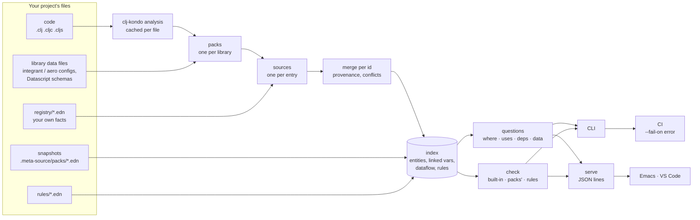

# How meta-source is built

How its pieces work together: what it reads, how the index is built, what
answers the questions, and how the editors and CI use it. For what it finds
and how to set it up, see the [README](../README.md).

meta-source is an index of the **ids** a codebase shares with its
registries (qualified keywords: `:shop/db`, `:user/email`, `:fn/place-order`)
and of everything that says something about them. Editors and CI ask that
index questions. In the editor you get hover, go to definition, find
references and problems, over the system's graph rather than the language's
symbols. In CI you get `check`.

## Ids, sources and facts

Everything is keyed by a qualified keyword, wherever it is written: a spec's
name, an integrant key, a Pathom resolver, a re-frame event, an atlas
entity. A **source** is one place that says something about an id. That
might be:
- an integrant config's entry;
- an `s/def`;
- a `defresolver`;
- an entry in one of your EDN files;
- the snapshot a running process wrote.

Each source gives **facts**: keys and values (`:data/privacy :pii`,
`:pathom/input [...]`). No source owns an id, so an EDN file can add a fact
to a key a spec defines.

## The index: one pass, nothing loaded

`meta-source.index/build` reads the project's files and returns the index:

1. **The code is analysed by clj-kondo**, with your `.clj-kondo` config,
   cached per file by modification time in `.meta-source/index.transit`. The
   analysis gives the forms each library uses to declare things, the vars
   and their metadata, the calls and the keywords used.
2. **Packs read those forms as data.** A pack finds its library's
   declaration sites in the analysis, such as every `(s/def …)` or
   `(defresolver …)`, and reads each form at its position, without
   evaluating it. Packs that read data files (integrant and aero configs,
   Datascript schemas) read the files instead. Something written as code,
   which can't be read as data, is reported as not read rather than guessed.
3. **Your registry files** (`registry/*.edn`) are read as maps of id to
   entry, keeping the line each key is written on.
4. **Sources merge per id.** Different keys combine. The same key with the
   same value is fine. The same key with different values is a conflict,
   naming every source that gave it: never last-write-wins. A pack can mark
   keys whose values union, such as a set of tags. Each entity keeps its
   provenance, meaning which source gave which key. Its primary definition
   is the place that declares it (the spec, the resolver, the component);
   facts in EDN are added to it.
5. **Vars are linked to ids**, by the meta key (`^{:meta-source/id …}`, or a
   library's own, such as atlas's `:atlas.source/id`) or by a pack (an
   `s/fdef` names its var). That gives "implemented by", and with the
   analysis's calls, "called from". An id only a var names is still an
   entity, a binding with nothing said about it yet.
6. **Snapshots of the running system**, written by a pack's runtime half,
   fill in what static reading couldn't read, and show where the code and
   the process disagree.
7. **Dataflow** comes from what entries say they consume and produce. That
   might be meta-source.edn's `:dataflow`, a pack's, or one derived from
   what was read (atlas's ontologies). It is what makes a data key's
   producers and consumers answerable.

## Questions and checks

Over the index, a few questions answer everything an editor or CI needs:

| Question | Answers |
|---|---|
| `where` | where an id is defined, by every source, and the var implementing it |
| `uses` | the entries that name it, and the code calling its var |
| `deps` | the ids its entry names |
| `data` | a data key's shape, producers and consumers |
| `check` | where the sources disagree, most severe first |

`check` has three kinds of findings:

- **meta-source's own:** conflicting facts, an id on two vars, a call a
  function's entry doesn't declare, keys read outside a contract.
- **Each pack's, about its library:** an `#ig/ref` to a key no config
  defines, a resolver input nothing produces, an event nothing registers,
  a transition to no state.
- **Your rules,** written as data over every source at once
  ([docs/reference.md](reference.md#your-own-rules)).

## Surfaces: CLI, serve, editors, CI

- **The CLI** (`meta-source where | uses | deps | data | check | summary |
  hover | diagnostics`) builds the index from the cache and answers once:
  EDN by default, or `--json`.
- **`meta-source serve`** keeps the index in memory and answers one JSON
  request per line on stdin with one JSON reply per line (`hover`, `check`,
  `diagnostics`, `summary`). Before each reply it re-reads only the files
  that changed, and `meta-source.edn` when it changed. An editor talks to
  this process.
- **Editors are thin clients of `serve`.**
  - **Emacs** (`emacs/meta-source.el`) starts one `serve` per project. Eldoc
    is the hover's summary line, `C-c .` its full text, `M-.` and `M-?` its
    definitions and references, and Flymake the file's diagnostics.
  - **VS Code** (`vscode/`) does the same, with the Clojure and the
    JavaScript reader side by side.
- **CI** runs `meta-source check --fail-on error`, which exits 1 when a
  problem is at least that severe.

Every answer comes from the same index, so the editor and CI never disagree.

## Two readers, one protocol

The **Clojure reader** (`src/`, in babashka with clj-kondo as a pod) and the
**JavaScript/TypeScript reader** (`js/`, in Node with TypeScript's parser)
share:
- `meta-source.edn` and the EDN registry files;
- the questions, with the same answer shapes;
- the `serve` protocol.

Each indexes the code in its own language. A JS/TS declaration names its id
in its JSDoc (`/** @meta-source/id :fn/x */`). About the registry itself,
both must answer the same:
[conformance/](../conformance) holds one registry implemented in both
languages, and `expected.json`, the Clojure reader's answers. `bb
conformance` and `npm test` check each reader against it.

## Extending it

- **A pack** is one map of functions (`:pack/find`, `:pack/read`,
  `:pack/checks`, `:pack/describe`…). Name yours by its qualified symbol in
  `meta-source.edn`'s `:packs`, with `:deps` to put it on the classpath
  ([docs/packs.md](packs.md)). A JS pack is a module with `entities`,
  `check` and `describe` ([js/README.md](../js/README.md#packs)). Libraries
  ship their own: atlas's registry is `atlas.meta-source/pack`, and its JS
  module adds an endpoint-call pack.
- **Rules** are EDN files of `{:when … :require …}` over entities and their
  relations.
- **The meta key** is `:meta-source/id` unless `:id-key` says otherwise.

## Where things are

| Piece | Clojure | JavaScript |
|---|---|---|
| EDN with each key's line | `meta_source/read.clj` | `js/src/edn.js` |
| merging sources | `meta_source/merge.clj` | `js/src/merge.js` |
| the index, questions, checks | `meta_source/index.clj` | `js/src/index.js`, `code.js` |
| rules | `meta_source/rules.clj` | — |
| hover, diagnostics, editor text | `meta_source/hover.clj` | `js/src/hover.js` |
| CLI and `serve` | `meta_source/cli.clj` | `js/bin/meta-source-js.js` |
| packs | `meta_source/pack/*.clj` | modules named in `:js {:packs …}` |
| editors | `emacs/meta-source.el` | `vscode/` (both readers) |
