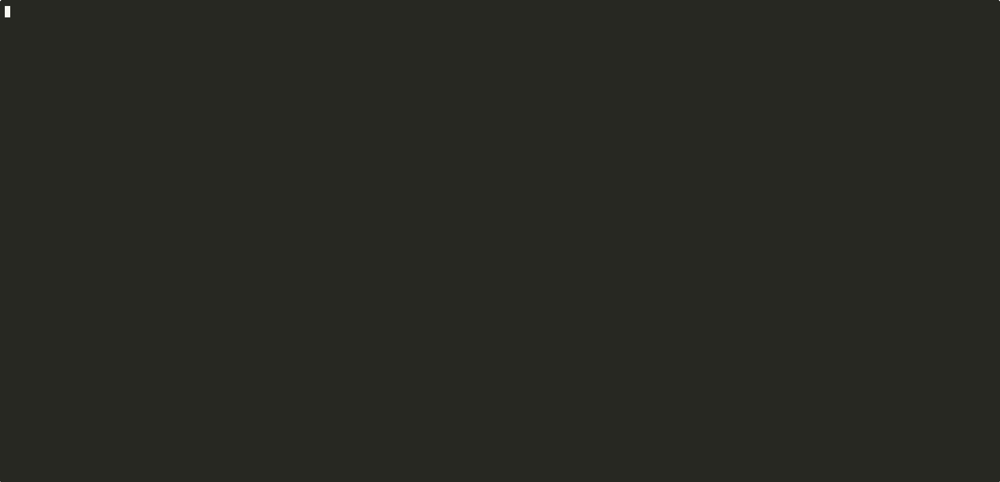

# Packs

A pack reads one library's own registry, where it is. Enable packs under
`:packs` in `meta-source.edn`.

This page is how to write a pack, and the two rules every pack shares:
how a key several sources describe is identified, and which keys carry
data. The core has one pack, the reference pack:
[a project's own namespaces](#a-projects-own-namespaces-the-namespaces-pack).
The packs for Clojure libraries (clojure.spec and malli, Pathom, integrant,
aero, re-frame, reitit, Datascript, tilakone, Overarch, grain) are a library
of their own, [meta-source-packs](https://github.com/semantic-namespace/meta-source-packs/blob/main/docs/packs.md): name it in
`meta-source.edn`'s `:deps`, and enable its packs under `:packs`.

For how packs fit into meta-source (the build each pack takes part in, and
what the index does for every pack), see [architecture.md](architecture.md#packs-one-contract-shared-machinery).

## Writing a pack

A pack is a map. A project enables its own by naming the var under
`:packs`, with its options as the value:

```clojure
{:packs {:spec {} app.source/job-pack {}}
 :deps {app/source-packs {:local/root "tools/source"}}}   ; when the pack isn't under :src
```

`:deps` puts the pack's code on meta-source's classpath, resolved as a
`deps.edn` would; a pack in the project's own `src` doesn't need it.

A library of packs is enabled by keys instead (`:spec`, `:integrant`): it
ships a `meta-source/packs.edn` resource naming each pack's var and the keys
that enable it, and meta-source reads every such resource on its classpath,
loading a pack only when `:packs` has one of its keys. The packs this page
describes are listed in [resources/meta-source/packs.edn](../resources/meta-source/packs.edn):

```clojure
[{:pack meta-source.pack.integrant/pack :config-keys #{:integrant}}
 {:pack meta-source.pack.schema/pack :config-keys #{:spec :malli}}]
```

A key under `:packs` that no pack on the classpath is enabled by is an
error naming it, and so is a pack whose `:pack/config-keys` aren't the
ones its `packs.edn` gives.

A pack needs `:pack/find` and `:pack/read` (forms in code), or
`:pack/data-files` and `:pack/read-data` (data files), or both. This one reads a project's
own `defjob` macro, and makes a job a consumer of the data keys it lists:

```clojure
(def job-pack
  {:pack/id :jobs
   :pack/kinds #{:job}                       ; the :kind of its sources; one pack per kind
   :pack/vocabulary #{"job"}                 ; the key namespaces its entries use
   :pack/dataflow {:consumes [:job/reads]}
   ;; where its forms are, from clj-kondo's analysis
   :pack/find (fn [analysis opts]
                (for [u (:var-usages analysis)
                      :when (and (= 'app.scheduler (:to u)) (= 'defjob (:name u)))]
                  (select-keys u [:filename :row :name-row :name-col])))
   ;; one file's forms, read as data; what it returns is cached, so it is data
   :pack/read (fn [sites {:keys [form-at own-ns]} opts]
                (vec (for [{:keys [row name-row name-col]} sites
                           :let [[_ nm job] (form-at name-row name-col)]]
                       {:row row :kind :job :dev-id (keyword own-ns (name nm)) :entry job})))
   :pack/describe (fn [entry] (some->> (:job/schedule entry) (str "job  ")))})
```

The optional keys:

| Key | What it gives |
|---|---|
| `:pack/config-keys` | for a pack a library lists in its `meta-source/packs.edn`, the `:packs` keys that enable it (the same the resource gives) |
| `:pack/data-keys?` | true when its entities are data keys, as a schema's are |
| `:pack/describes?` | true when it describes what other packs declare, as atlas's registry describes an integrant component under its key: sharing their ids is no `:id-in-several-packs`, and their source stays the id's primary definition |
| `:pack/depicts?` | true when it is a picture of the system, as an architecture model is: never an id's primary definition while anything else defines it |
| `:pack/checks` | `(fn [view])` → problems; `view` has `:entities`, `:of-kinds`, `:data-key?`, `:loc`, `:flow`, `:opts`, `:var-defined?` (a qualified symbol: true, false, or nil when its namespace wasn't read), `:not-read` (a kind: how many forms couldn't be read), `:impl` (an id: where its var is, or nil) and `:linked-by` (an id: the pack whose `:pack/id-key` linked its var, or nil) and `:namespaces` (the names of the namespaces the analysis read) |
| `:pack/schema-call?` | `(fn [call opts])` → true when a call (clj-kondo's var usage: `:to` its namespace, `:name`) names a schema rather than reads a key; keywords inside it aren't key reads for `:keys-outside-contract`. The schema pack says it of clojure.spec and malli calls and of `:schema-fns` |
| `:pack/messages` | `{problem (fn [problem id keys])}` → the line the editor and `check --brief` show for each problem its checks give; `id` is the problem's `:dev-id` and `keys` its `:keys` (or the one key a diagnostic is about), both as written. A problem with none falls back to its name, id, keys and `:reason` |
| `:pack/inexact` | `{reason {:pattern rule-id :lost "..."}}`: how it names an edge through code that isn't exact, when its entities are involved (the built entity, or the component at fault): the rule of its pattern broken and what is lost, reported as `:off-pattern` when a pack involved has `:pattern true`. The reasons are the index's: `:inexact/hands-unknown` (what a builder hands isn't known), `:inexact/config-outside-builds` (a builder uses its config beside the calls that build), `:inexact/inline-uses-config` (an entity written in a component that uses its config), `:inexact/holder-wraps` (what takes the built entity holds other components). Integrant names the first (`:pattern/integrant-destructure`), Reitit the rest. One no pack names is reported under the reason itself |
| `:pack/inline-data-keys` | `(fn [entities])` → data keys its entities define with no entity of their own |
| `:pack/shape`, `:pack/members` | a data key's shape as text, and the keys a schema is made of |
| `:pack/describe` | one line for the hover |
| `:pack/merge` | `{key :union}`: keys whose values it unions across sources, rather than reporting different values as a conflict |
| `:pack/dataflow` | `{:consumes [k ...] :produces [k ...]}`: entry keys listing the data keys its entities read and give |
| `:pack/dataflow-of` | `(fn [entries])` → the same, derived from what was read (`{id entry}`): atlas's pack takes a project's ontologies' context and response keys, so a project's own entity types need no `:dataflow` line |
| `:pack/derive` | `(fn [entities opts])` → `{id {key value}}`: facts derived from what every pack read, `entities` being `{id {:entry merged-entry :kinds #{source-kind}}}`. atlas's pack gives a route described in EDN its `:atlas/type`. A derived fact fills a key the entry lacks, never one a source gave, so it can't conflict; `where` lists it with `:derived-by` |
| `:pack/rules-of` | `(fn [entries])` → `{rule-id rule}`, rules as a rules file holds them, derived from what was read: atlas's pack takes the rules a project's invariants carry. They are checked with the project's own, and a rule whose id is an entity's is located at that entity |
| `:pack/id-key` | its library's meta key linking a var to an id (atlas's `:atlas.source/id`), read as `:id-key` is, with no configuration. A var it links that no source describes is the pack's to report, so meta-source's `:binding-only` is left out for it |
| `:pack/var-meta` | meta keys whose values clj-kondo's analysis gives on each var definition, for `:pack/find` (the function-contracts pack reads `:malli/schema`) |
| `:pack/kondo-config` | clj-kondo config the analysis adds, as a library's own exported config would (`{:lint-as {malli.experimental/defn schema.core/defn}}`) |
| `:pack/data-files`, `:pack/read-data` | a pack that reads data files rather than code: `(fn [opts])` gives paths (files, or directories of `.edn`), and `(fn [files opts])` reads all of them at once, so a key several files define can be one result. `meta-source.read/keyed-lines` reads EDN with each key's line, keeping unknown tags |
| `:pack/runtime-fill`, `:pack/runtime-diff` | its runtime half: `(fn [entry runtime])`, filling what static reading couldn't read, and saying where code and the running process disagree. The process writes `{:pack id :written ms :entities {...}}` to `.meta-source/packs/<id>.edn` (or the pack's `:snapshot` option) |
| `:pack/runtime-kinds` | the source kinds its runtime snapshot is compared with, by default its own; a pack whose declarations also live in EDN registry files includes `:edn` |

`form-at` reads the form whose head symbol is at a row and column, with
`::keywords` resolved and `.cljc` reader conditionals read as `:clj`;
`find-row` gives the first line from a row on where some text is written,
to place what a form holds at its own line. A result is
`{:row :kind :dev-id :entry}`, or `{:row :kind :skipped reason}` when the
form can't be read; a skipped result with `:pattern rule-id` breaks that
rule of the pack's pattern ([pattern.md](https://github.com/semantic-namespace/meta-source-packs/blob/main/docs/pattern.md)), reported as
`:off-pattern` when the pack's options say `:pattern true`. With `:refers true`, it is a place that refers to the
id (a dispatch, a link), never its primary definition; with `:var ns/name`,
that var implements the id, as the meta key does. Failures are reported,
never thrown: the index reports those as `:pack-form-not-read` and
counts each kind's reads in `meta-source summary`. A pack that throws on a
file is reported the same way, for that file, and one whose `:pack/find`
throws, at the first file. Two packs giving the same
`:kind` are refused; a `:refer` in an `ns` form is never handed to a pack, and
neither is a form inside a `(comment ...)` block, which is REPL scratch. `bb smoke core` runs packs like this one (`bb/smoke/packs.clj`) over `test/fixtures/core`.

## What the index doesn't cover: `:not-covered`

meta-source reads conventions: what a project declares as data. What it
doesn't read, it says, rather than passing over it (`:not-covered`, info):

- the project's source files in a language the index doesn't read (Kotlin,
  Java, TypeScript, JavaScript, …), anywhere under the root except hidden
  directories, dependencies (`node_modules`) and build output (`target`,
  `build`, `dist`, `out`), with how many and where most of them are;
- a library declaring a system's structure that the project calls and no
  enabled pack reads: Pedestal (routes and interceptors), Compojure, bidi and
  Ataraxy (routes), Component, mount, donut.system and clip (a system), with
  the files calling it. A pack that reads one names its namespaces in
  `:pack/covers`, and it isn't reported.

What the project knows isn't read here, because another tool reads it, it
states in `meta-source.edn`, and it isn't said again:

```clojure
:not-covered {:languages ["JavaScript" "TypeScript"]   ; read by our JS tooling
              :libraries ["Pedestal"]}
```

A system a function returns is outside the conventions too: the integrant
pack reports `:checks-not-run` for it and concludes nothing from it.

## One id, two packs

Data keys are global: a spec and a malli schema shaping `:user/email` are one
entity. A spec under a component's own key, as integrant systems often have, is
that component's shape: the entity stays a component, with `:spec/form` beside
its `:integrant/*` keys. Two packs that declare things giving one id (a Pathom
resolver and an integrant component, say) are two things under one name, and
`check` reports `:id-in-several-packs` (warning).

## Which keys carry data: `:dataflow`

An entry consumes or produces data keys through the keys `:dataflow` lists, in
`meta-source.edn`, in any vocabulary:

```clojure
{:dataflow {:consumes [:job/reads] :produces [:job/writes]}}
```

Each pack adds its own (the Pathom pack: `:pathom/input`, `:pathom/params`,
`:pathom/output`). With this, a nightly job written as
`{:job/nightly-digest {:job/reads [:user/email]}}` is a consumer of
`:user/email`. The core fixture (`test/fixtures/core`) describes its plain
functions this way (`:fn/reads`, `:fn/returns`).

## A project's own namespaces: the namespaces pack

```clojure
:namespaces {:roots {org.acme.shop shop}}
```

The pack gives each of the project's namespaces an id, by a naming convention
the project states: the roots it maps. A namespace under a root is an entity
whose id is the rest of its name, its last segment the id's name:
`org.acme.shop.orders.api` is `:shop.orders/api`, `org.acme.shop.db` is
`:shop/db`. When a namespace is under several roots, the longest maps it.
Read from clj-kondo's analysis; nothing is loaded.

```clojure
#:meta-source{:ns "org.acme.shop.orders.api"
              :requires [:shop/db :shop.orders/model]}
```

`:meta-source/requires` names what it requires under a root. A library's
namespaces aren't the system's, and aren't named. So `deps` on a namespace
lists what of the project it requires, `uses` what requires it, and rules say
which may require which. meta-source's own layering, checked on its own
source (`rules/architecture.edn`):

```clojure
{:meta-source.architecture/packs-stand-alone
 {:doc "A pack requires only read and other packs"
  :severity :error
  :when {:id-ns "meta-source.pack"}
  :require [{:deps {:all {:or [{:id-ns "meta-source.pack"} {:id :meta-source/read}]}}}]}}
```

A violation is reported at the namespace's `ns` form, naming what it requires,
and for `:reaches` the path: `:meta-source/index (:meta-source/read →
:meta-source/hover)`.

The ids are the ones the rest of the project can use. An architecture
model's component or an atlas entity written under the same id is the same
entity, and what it says about the namespace is compared with what the
namespace requires.

Nothing is guessed: a namespace is under a root or it isn't. A root
namespace itself has no name under the root to give its id. It isn't read,
and with `:pattern true` in the pack's options it is `:off-pattern`
(`:pattern/namespace-under-root`).


