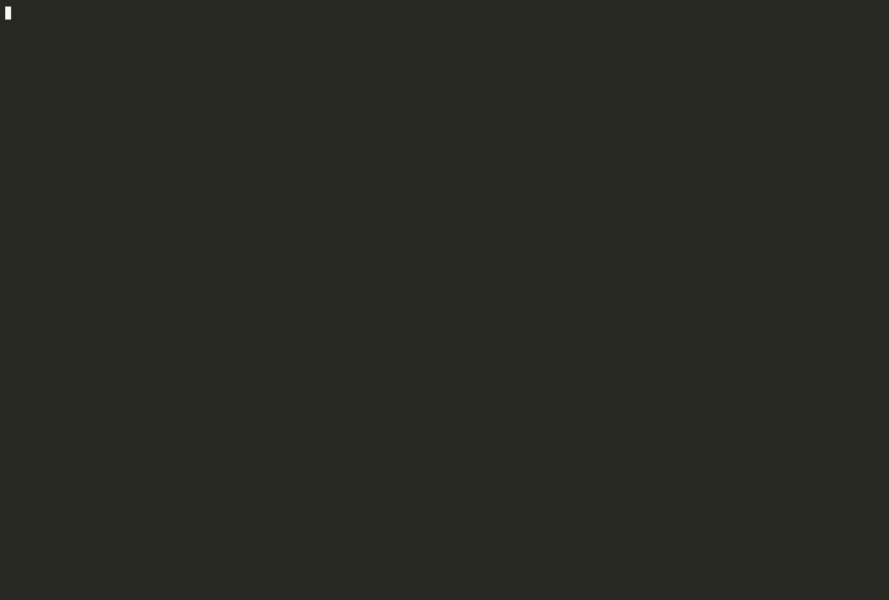
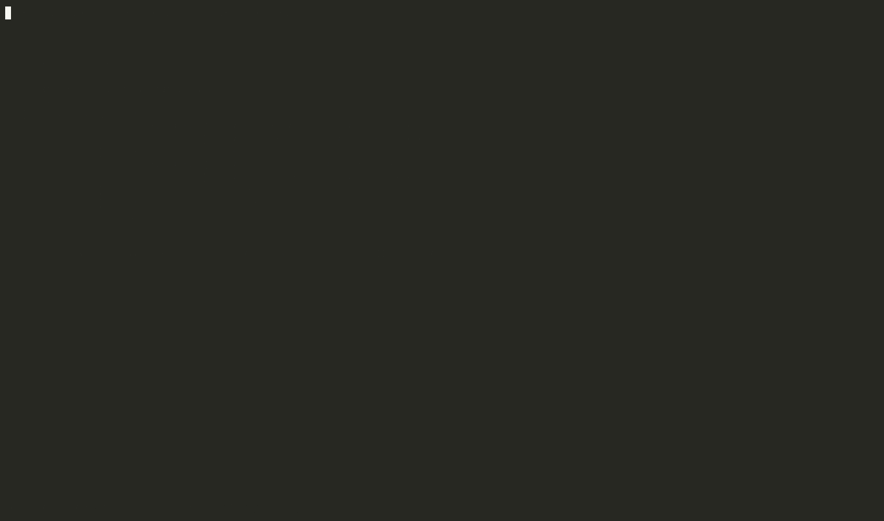

# Packs

A pack reads one library's own registry, where it is. Enable packs under
`:packs` in `meta-source.edn`.

This page starts with how to write a pack, and the two rules every pack
shares: how a key several sources describe is identified, and which keys
carry data. Then it describes the built-in packs:

- [Data keys from clojure.spec and malli: the schema pack](#data-keys-from-clojurespec-and-malli-the-schema-pack)
- [Resolvers and mutations: the Pathom pack](#resolvers-and-mutations-the-pathom-pack)
- [A system's components: the integrant pack](#a-systems-components-the-integrant-pack)
- [A config's environment and includes: the aero pack](#a-configs-environment-and-includes-the-aero-pack)
- [Events and subscriptions: the re-frame pack](#events-and-subscriptions-the-re-frame-pack)
- [Routes: the reitit pack](#routes-the-reitit-pack)
- [A database's attributes: the Datascript pack](#a-databases-attributes-the-datascript-pack)
- [State machines: the tilakone pack](#state-machines-the-tilakone-pack)

For how packs fit into meta-source (the build each pack takes part in, and
what the index does for every pack), see [architecture.md](architecture.md#packs-one-contract-shared-machinery).

## Writing a pack

A pack is a map; the built-in ones are `meta-source.pack.schema/pack`,
`meta-source.pack.pathom/pack` and `meta-source.pack.integrant/pack`. A project enables its own by naming the var
under `:packs`, with its options as the value:

```clojure
{:packs {:spec {} app.source/job-pack {}}
 :deps {app/source-packs {:local/root "tools/source"}}}   ; when the pack isn't under :src
```

`:deps` puts the pack's code on meta-source's classpath, resolved as a
`deps.edn` would; a pack in the project's own `src` doesn't need it.

A pack needs `:pack/find` and `:pack/read` (forms in code), or
`:pack/data-files` and `:pack/read-data` (data files), or both. This one reads a project's
own `defjob` macro, and makes a job a consumer of the data keys it lists:

```clojure
(def job-pack
  {:pack/id :jobs
   :pack/kinds #{:job}                       ; the :kind of its sources; one pack per kind
   :pack/vocabulary #{"job"}                 ; the key namespaces its entries use
   :pack/dataflow {:consumes [:job/reads]}
   ;; where its forms are, from clj-kondo's analysis
   :pack/find (fn [analysis opts]
                (for [u (:var-usages analysis)
                      :when (and (= 'app.scheduler (:to u)) (= 'defjob (:name u)))]
                  (select-keys u [:filename :row :name-row :name-col])))
   ;; one file's forms, read as data; what it returns is cached, so it is data
   :pack/read (fn [sites {:keys [form-at own-ns]} opts]
                (vec (for [{:keys [row name-row name-col]} sites
                           :let [[_ nm job] (form-at name-row name-col)]]
                       {:row row :kind :job :dev-id (keyword own-ns (name nm)) :entry job})))
   :pack/describe (fn [entry] (some->> (:job/schedule entry) (str "job  ")))})
```

The optional keys:

| Key | What it gives |
|---|---|
| `:pack/config-keys` | for a built-in pack, the `:packs` keys that enable it |
| `:pack/data-keys?` | true when its entities are data keys, as a schema's are |
| `:pack/describes?` | true when it describes what other packs declare, as atlas's registry describes an integrant component under its key: sharing their ids is no `:id-in-several-packs`, and their source stays the id's primary definition |
| `:pack/depicts?` | true when it is a picture of the system, as an architecture model is: never an id's primary definition while anything else defines it |
| `:pack/checks` | `(fn [view])` → problems; `view` has `:entities`, `:of-kinds`, `:data-key?`, `:loc`, `:flow`, `:opts`, `:var-defined?` (a qualified symbol: true, false, or nil when its namespace wasn't read), `:not-read` (a kind: how many forms couldn't be read), `:impl` (an id: where its var is, or nil) and `:linked-by` (an id: the pack whose `:pack/id-key` linked its var, or nil) and `:namespaces` (the names of the namespaces the analysis read) |
| `:pack/inline-data-keys` | `(fn [entities])` → data keys its entities define with no entity of their own |
| `:pack/shape`, `:pack/members` | a data key's shape as text, and the keys a schema is made of |
| `:pack/describe` | one line for the hover |
| `:pack/merge` | `{key :union}`: keys whose values it unions across sources, rather than reporting different values as a conflict |
| `:pack/dataflow` | `{:consumes [k ...] :produces [k ...]}`: entry keys listing the data keys its entities read and give |
| `:pack/dataflow-of` | `(fn [entries])` → the same, derived from what was read (`{id entry}`): atlas's pack takes a project's ontologies' context and response keys, so a project's own entity types need no `:dataflow` line |
| `:pack/derive` | `(fn [entities opts])` → `{id {key value}}`: facts derived from what every pack read, `entities` being `{id {:entry merged-entry :kinds #{source-kind}}}`. atlas's pack gives a route described in EDN its `:atlas/type`. A derived fact fills a key the entry lacks, never one a source gave, so it can't conflict; `where` lists it with `:derived-by` |
| `:pack/rules-of` | `(fn [entries])` → `{rule-id rule}`, rules as a rules file holds them, derived from what was read: atlas's pack takes the rules a project's invariants carry. They are checked with the project's own, and a rule whose id is an entity's is located at that entity |
| `:pack/id-key` | its library's meta key linking a var to an id (atlas's `:atlas.source/id`), read as `:id-key` is, with no configuration. A var it links that no source describes is the pack's to report, so meta-source's `:binding-only` is left out for it |
| `:pack/var-meta` | meta keys whose values clj-kondo's analysis gives on each var definition, for `:pack/find` (the function-contracts pack reads `:malli/schema`) |
| `:pack/kondo-config` | clj-kondo config the analysis adds, as a library's own exported config would (`{:lint-as {malli.experimental/defn schema.core/defn}}`) |
| `:pack/data-files`, `:pack/read-data` | a pack that reads data files rather than code: `(fn [opts])` gives paths (files, or directories of `.edn`), and `(fn [files opts])` reads all of them at once, so a key several files define can be one result. `meta-source.read/keyed-lines` reads EDN with each key's line, keeping unknown tags |
| `:pack/runtime-fill`, `:pack/runtime-diff` | its runtime half: `(fn [entry runtime])`, filling what static reading couldn't read, and saying where code and the running process disagree. The process writes `{:pack id :written ms :entities {...}}` to `.meta-source/packs/<id>.edn` (or the pack's `:snapshot` option) |
| `:pack/runtime-kinds` | the source kinds its runtime snapshot is compared with, by default its own; a pack whose declarations also live in EDN registry files includes `:edn` |

`form-at` reads the form whose head symbol is at a row and column, with
`::keywords` resolved and `.cljc` reader conditionals read as `:clj`;
`find-row` gives the first line from a row on where some text is written,
to place what a form holds at its own line. A result is
`{:row :kind :dev-id :entry}`, or `{:row :kind :skipped reason}` when the
form can't be read; a skipped result with `:pattern rule-id` breaks that
rule of the pack's pattern ([pattern.md](pattern.md)), reported as
`:off-pattern` when the pack's options say `:pattern true`. With `:refers true`, it is a place that refers to the
id (a dispatch, a link), never its primary definition; with `:var ns/name`,
that var implements the id, as the meta key does. Failures are reported,
never thrown: the index reports those as `:pack-form-not-read` and
counts each kind's reads in `meta-source summary`. A pack that throws on a
file is reported the same way, for that file, and one whose `:pack/find`
throws, at the first file. Two packs giving the same
`:kind` are refused; a `:refer` in an `ns` form is never handed to a pack. `bb smoke` runs a pack like this one.

## One id, two packs

Data keys are global: a spec and a malli schema shaping `:user/email` are one
entity. A spec under a component's own key, as integrant systems often have, is
that component's shape: the entity stays a component, with `:spec/form` beside
its `:integrant/*` keys. Two packs that declare things giving one id (a Pathom
resolver and an integrant component, say) are two things under one name, and
`check` reports `:id-in-several-packs` (warning).

## Which keys carry data: `:dataflow`

An entry consumes or produces data keys through the keys `:dataflow` lists, in
`meta-source.edn`, in any vocabulary:

```clojure
{:dataflow {:consumes [:job/reads] :produces [:job/writes]}}
```

Each pack adds its own (the Pathom pack: `:pathom/input`, `:pathom/params`,
`:pathom/output`). With this, a nightly job written as
`{:job/nightly-digest {:job/reads [:user/email]}}` is a consumer of
`:user/email`. The shop fixture describes its plain functions this way
(`:fn/reads`, `:fn/returns`).

## Data keys from clojure.spec and malli: the schema pack

A project that already shapes its data keys with clojure.spec or malli can
have the index read those shapes. Name the pack in `meta-source.edn`:

```clojure
{:registry ["registry"] :src ["src"]
 :packs {:spec {}                                    ; every s/def call
         :malli {:registries [shop.schema/registry]}}} ; vars holding a malli registry map
```

Each `s/def` and each qualified registry entry becomes an entity keyed by its data key (an unqualified one, like `:map`, overrides a malli schema and is skipped),
in the pack's own vocabulary: `:spec/form`, and for `s/keys` the
`:spec/req`, `:spec/opt`, `:spec/req-un` and `:spec/opt-un` keys; `:malli/form`,
and for a `:map` its qualified `:malli/keys` and its `:malli/unqualified-keys`.
Forms are kept as text. Nothing is loaded; `.cljc` reader conditionals are
read as `:clj`.

A data key is one entity whatever describes it, so a registry file can add
facts the schema has no place for:

```clojure
;; registry/privacy.edn
{:user/email {:data/privacy :pii}}
```

`meta-source data :user/email` then gives its shape and where it is written,
`:data/privacy :pii`, the `s/keys` it belongs to, and who produces and
consumes it. The hover shows the same. Data keys are not listed as
dependencies.

`check` adds, all as info:

- `:schema-key-without-shape`: an `s/keys` names a key with no spec of its own.
  spec allows it, and it is also how a typo looks;
- `:unqualified-schema-keys`: a malli `:map` with unqualified keys, which no
  dataflow query can follow;
- `:data-key-without-schema`: keys in an entity's contract that no schema shapes;
- `:pack-form-not-read`: an `s/def` or registry the pack couldn't read (any pack reports what it couldn't read this way, with `:pack` and `:reason`).

Keys a schema shapes also count as data keys for `:keys-outside-contract`, so
code that reads a spec'd key its contract doesn't name is reported even when
no other contract names that key.

Not read yet: specs or schemas declared through a project's own wrapper fn or
macro, and malli schemas held in vars rather than a registry. Every entry of
a malli registry gets the line of its `def`. On a 535-file app the pack read
1,770 `s/def` calls, none unreadable; `test/fixtures/shop` is a small project
using both libraries, checked by `bb smoke`, which also covers the Pathom pack
below.

### Function contracts: `s/fdef` and `m/=>`

The same `:spec` and `:malli` keys read the function contracts the code
already writes. Each `s/fdef` and `m/=>` becomes an entity keyed by its
function's var, `ns/name` as a keyword, and that var implements it with no
meta key:

```clojure
(s/fdef total :args (s/cat :order ::order) :ret ::receipt)
;; :shop.checkout/total
#:spec{:args "(s/cat :order :shop.checkout/order)" :args-keys [:shop.checkout/order]
       :ret ":shop.checkout/receipt" :ret-keys [:shop.checkout/receipt]}
```

- `:spec/args-keys` and `:spec/ret-keys` are the specs `:args` and `:ret`
  name, leaving out the tags of `s/cat`, `s/alt` and `s/or`. They are what the
  function consumes and produces, so `meta-source data ::order` lists the
  functions taking an order.
- From `m/=>`, `:malli/args-keys` and `:malli/ret-keys` come from each `:=>`
  or `:->` in the schema (`:function` arities among them), with inline `:map`
  keys.

A function contract makes `:keys-outside-contract` work for plain functions:
code reading a data key that neither its contract nor the keys of the specs
it names list. A key in `::order`'s `s/keys` is within a function taking
`::order`. A keyword written inside a clojure.spec or malli call
(`(s/valid? ::order x)`) names a schema, and doesn't count as a key read; so
does one inside a call to a project's own fn that takes a schema, named under
`:schema-fns`:

```clojure
:malli {:schema-fns [app.schema/validate]}   ; (schema/validate ::message x) reads no key
```

A var with both an `s/fdef` and the meta key implements both ids. Only a var linked by the meta key is
checked for `:undeclared-call`, since an fdef lists no calls.

On [hermes](https://github.com/wardle/hermes), the pack read 114 `s/fdef`s.
One function reads keys outside its contract: `ctu->cf+normalize` returns
`:cf/definition-status`, `:cf/focus-concepts`, `:cf/groups` and
`:cf/ungrouped`, and its fdef has no `:ret`. Its `s/keys*` options name four
keys with no spec of their own (`::nthreads`, `::batch-size`...), reported as
`:data-key-without-schema`.

With `:malli`, a `defn`'s own `{:malli/schema [:=> ...]}` metadata (as
clj-kondo's analysis gives it) and malli.experimental's `mx/defn` `:-`
annotations are read the same way: `mx/defn`'s become `[:=> [:cat ...] ret]`,
one per arity, and clj-kondo is told that `mx/defn` defines a var, as malli's
own exported clj-kondo config does. An `mx/defn` with no `:-` is a plain
function, with no contract.

On three malli codebases, read only:

| | Read | Found |
|---|---|---|
| [repath-studio](https://github.com/repath-studio/repath-studio) (re-frame and malli) | 541 `m/=>` and `mx/defn`, 1,724 re-frame registrations and references | its REPL namespace dispatches `::element.events/boolean-unite` and four like it; no such events exist (the event is `::boolean-operation`, with the operation as its argument) |
| [Olical/clojure-dap](https://github.com/Olical/clojure-dap) | 42 `mx/defn` | with `:schema-fns`, one `::anomaly` in a schema literal the fn returns (`[:or schema ::anomaly]`), not a key read |
| [clj-commons/antq](https://github.com/clj-commons/antq) | 22 `{:malli/schema ...}` | nothing |

The contract check reads keywords, so a schema name written as a value
outside a schema call (`[:or schema ::anomaly]`) still counts as a key the
fn uses.

## Resolvers and mutations: the Pathom pack

Pathom resolvers already say what they consume and produce. With
`:packs {:pathom {}}`, each `defresolver` and `defmutation` (Pathom 3,
`com.wsscode.pathom3.connect.operation`, and Pathom 2,
`com.wsscode.pathom.connect`) becomes an entity keyed by its op-name, `ns/name`
as a keyword:

```clojure
:shop.resolvers/order-total
#:pathom{:op :resolver
         :input [:order/lines]
         :output [:order/total]
         :inferred #{:input :output}}
```

- `:pathom/input`, `:pathom/params` (a mutation's) and `:pathom/output` come
  from `::pco/input`, `::pco/params` and `::pco/output`. Output joins
  contribute their key and the keys inside them.
- When they aren't written, they are inferred as Pathom 3 does: the input from
  the destructuring of the input argument, the output from a map literal
  returned last. `:pathom/inferred` says which.
- An option may name a `def` in the same file whose value is data
  (`{::pco/output concept-properties}`); it is read through it.
- An option written as code (`(->> registry keys vec)`) is not guessed:
  `:pathom/not-read` lists it, and `check` reports it.
- A project's own wrapper macro that takes `defresolver`'s or `defmutation`'s
  arguments is read when named: `:pathom {:resolver-macros [app.connect/defresolver]
  :mutation-macros [...]}`.

Resolvers are producers and consumers next to everything else.
`meta-source data :user/email` lists the resolvers that need it alongside the
functions whose contracts produce it, its spec and its privacy class. `check`
adds, as info:

- `:input-without-producer`: a resolver needs a key that nothing produces, no
  resolver and no other contract. The query can still pass it in (that is how
  a graph's entry points look); when nothing does, the resolver is
  unreachable. Not reported while some operation's output couldn't be read:
  any of them may produce the key, and `:operation-option-not-read` says
  which;
- `:operation-option-not-read`: an input, params or output written as code;
- `:pack-form-not-read` with `:pack :pathom`: a form the pack couldn't read.

On two open-source Pathom 3 apps:

| | Operations read | Notes |
|---|---|---|
| [hermes](https://github.com/wardle/hermes) (SNOMED CT server) | 38 of 38, plus 227 `s/def` | one unproduced input: `:info.snomed/id`, the graph's entry point; one `s/keys` naming optional keys with no spec |
| [duck-repled](https://github.com/mauricioszabo/duck-repled) | 29 of 29 through its wrapper macro, plus 38 malli registry entries | the seed resolver's output is code, so unproduced inputs name it; two resolver outputs (`:var/spec`, `:repl/cljs`) are missing from the registry its wrapper validates against, so they are never validated |

Not read from the code: `pco/resolver` and `pco/mutation` calls (resolvers
built as values), dynamic resolvers, and options naming a def in another
namespace. kondo doesn't attribute the keywords inside a resolver's body to it,
so `:keys-outside-contract` doesn't cover resolvers. The running environment
covers the first three:

### What the running environment registered: the Pathom snapshot

A running Pathom environment holds the exact index of what it registered,
however each operation was built. Write it from the app's REPL, or wherever
the env is built:

```clojure
(meta-source.pack.pathom/snapshot! [env])   ; Pathom 3 env, or Pathom 2 indexes; several at once
;; => ".meta-source/packs/pathom.edn"
```

Pathom need not be on meta-source's classpath, nor meta-source on the app's
beyond this one call: the index is read by keyword. The file is
`{:pack :pathom :written <ms> :entities {op-id entry}}`, in the pack's
vocabulary; `:pathom {:snapshot "path"}` in `meta-source.edn` reads it from
elsewhere. With it, the index:

- **fills** what reading the code couldn't: an output written as code takes
  the registered one, listed under `:pathom/from-runtime`, so the inputs it
  produces are no longer reported as unproduced;
- **adds** what only the environment has, such as a `pco/resolver` value, as
  an entity the hover marks "running process";
- **checks**, beside the static checks:
  - `:runtime-disagrees` (warning): an operation whose inputs, params or
    outputs differ between the code and the environment, with the keys only
    each side has. `:changed-since-snapshot` is true when the file changed after
    the snapshot was written, so the snapshot may be the stale side;
  - `:not-in-runtime` (info): defined in the code, never registered;
  - `:runtime-only` (info): registered, in no file the pack read.

`meta-source summary` gives the snapshot's file, time and count under
`:pack-snapshots`. On the shop fixture, a snapshot from real Pathom 3 and 2
agrees with the code on all nine operations both have. `bb pathom-snapshot-check`
rebuilds it from real Pathom and fails if the operations change.

## A system's components: the integrant pack

```clojure
:integrant {:configs ["resources/config"]   ; config files, or directories of .edn
            :vars [app.system/config]       ; configs written in code
            :provided [:duct/logger]        ; keys something else adds, like a duct module
            :pattern true}                  ; report where the system leaves the pattern
```

Each config key becomes a component, in the pack's own vocabulary:

```clojure
:shop/db
#:integrant{:config-in ["resources/system.edn:2" "resources/system.test.edn:2"]
            :env ["DATABASE_URL"]           ; aero's #env, from any branch
            :varies true                    ; the files configure it differently
            :init-key true :halt-key! true} ; the defmethods the code has
```

- `:integrant/refs` comes from `#ig/ref` and `#ig/refset` anywhere in the
  config, `(ig/ref k)` in a config written in code. Refs are references, so
  `meta-source uses :shop/db` lists the components that need it, and an EDN
  contract naming a component in its deps links a function to it.
- Config files are read all at once: a key that a `.mock.edn` or test variant
  configures too is one component with every file listed, not a conflict.
  Tags no reader knows (`#env`, `#or`, `#profile`) are kept as data.
- A composite key is named by the keyword no other config key uses, the others
  being what it derives from (`:integrant/derives`): `:app/web` in duct's
  `[:duct/server :app/web]`, and `:password.slack/webhook` in
  `[:password.slack/webhook :app/rotable-password]` when every password shares
  the second. Projects write them both ways round. When the config doesn't single
  one out, the last keyword is the name.
- A duct profile key (`:duct.profile/base {...}`) holds components, each read
  as one with `:integrant/profiles`.
- A config's system may sit under one of its keys, as an aero config often
  has it (`{:port 3000 :app/system {...}}`): a top-level key whose map refers
  to its own keys is read as the system, or name it with `:system-keys`.
- A key a tag chooses (`#profile{:dev ::logging :prod ::sendgrid} {...}`)
  configures each of its branches.
- duct's merge hints on a tag (`^:replace #ig/ref :k`) are read past.
- The keys an `expand-key` (or `prep-key`, or a duct module's `init-key`)
  writes as map keys are what it adds to the system.
- An `init-key` (or `expand-key`, `prep-key`) method is its component's
  code: what it calls is what the component calls, and a route or other
  entity defined in a fn it calls is provided by the component (`reach`, and
  `:reaches` in rules), and depends on what the call is handed: the
  components behind the config keys the method's destructuring passes it,
  read through clj-kondo's locals. That is exact on the pattern
  ([pattern.md](pattern.md), I5 and R4); off it, the route's reach is said
  not exact, never guessed. A ref resolves as integrant resolves it, a
  refset on a key others derive from included.
- `integrant/hierarchy.edn` and `duct_hierarchy.edn` under `src/` or
  `resources/` (or the files `:hierarchies` names) are read as derive calls,
  as `ig/load-hierarchy` reads them; so is what duct's own libraries derive
  (`:duct.migrator/ragtime` from `:duct/migrator`, `:duct.server.http/jetty`
  from `:duct.server/http`...), as their jars say, and the keys the sql,
  logging and web modules add.
- `(derive child parent)` calls are read wherever they are
  (`:integrant/isa`), and followed at any depth. In a file that doesn't use
  integrant, where `derive` may build a hierarchy of exceptions, the call
  only refers to the key and is never its definition.
- `#ig/var` names (`:integrant/vars`), and those a file declaring Duct's
  `:vars` doesn't bind (`:integrant/unbound-vars`). Duct's
  `{:vars {...} :system {...}}` is read from `:system`.
- `defmethod`s of integrant's multimethods (`init-key`, `halt-key!`,
  `pre-init-spec`…) are read from the form, so `::keywords` get the file's
  namespace. clj-kondo's own dispatch string gives them the wrong one.

`check` adds:

- `:ref-to-undefined` (warning): a ref (a refset may match nothing, as
  integrant allows; a composite ref must match a key deriving from all of
  it) to a key no config read defines,
  directly, as a composite's parent or by `derive`, that no configured duct
  module adds (`:duct.module/logging` adds `:duct/logger`,
  `:duct.module/sql` `:duct.database/sql`), and not `:provided`;
- `:ref-maybe-from-module` (info): such a ref in the namespace of a key that
  expands into others (an `expand-key` or `prep-key`, or a duct module), which
  may add it. What such a key adds is read from its method, where the body
  writes the keys as data (`{::app {}}`); a key it builds isn't read;
- `:ref-ambiguous` (warning): a ref (not a refset) that more than one key
  configured together matches, by being it or deriving from it (a composite
  key, a `derive`, a hierarchy file). Integrant can't choose and `ig/init`
  fails. Keys in different config files, in duct profiles not active
  together, or the branches of one `#profile` key are alternatives, not rivals;
- `:ref-cycle` (warning): components whose refs or refsets go round in a
  circle, shown as the shortest path back to the first: `ig/init` can't
  order them;
- `:init-key-without-config` (info): an `init-key` for a key nothing configures
  or derives from: unused, or configured somewhere not read;
- `:ref-invalid` (warning): an `#ig/ref` or `#ig/refset` to something other
  than a qualified keyword or a vector of them (`#ig/ref :db`): `ig/ref`
  throws reading the config;
- `:var-unbound` (warning): an `#ig/var` the file's Duct `:vars` doesn't
  bind: `ig/init` throws `::unbound-vars`. A config with no `:vars` may be
  bound by `ig/bind` in code, and isn't checked;
- `:no-init-key` (warning): a configured key with no `init-key` on itself or
  anything it derives from, and no fn named like it or a part of its
  composite (integrant 0.10's default `init-key`): `ig/init` throws
  `::missing-init-key`. Only keys whose every keyword is under the project's
  own namespaces count, since a library's key is built by the library; nor
  do keys that expand, or that `:provided` names;
- `:removed-method`: a `pre-init-spec` (removed in 0.9, replaced by
  `assert-key`) or `prep-key` (removed in 1.0, replaced by `expand-key`). A
  warning when the project's `deps.edn` or `project.clj` asks for a version
  without it, nothing when it asks for one with it, an info when it doesn't
  say.

With `:pattern true`, `:off-pattern` (info, `:pattern/integrant-destructure`):
an `init-key` whose config parameter isn't destructured with literal
`:keys`, or that hands a call the whole config or a value bound in its body.
What that call builds (a router, its routes) then reaches everything the
component refers to, not what it was handed. See [the pattern](pattern.md).

On real systems:

| | Read | What was left |
|---|---|---|
| a production app, 18 config files | 409 components, defmethods and derives | 16 `init-key`s no config read configures; of the four checked, two are configured nowhere in the repo, one only in tests, one in code |
| [Swirrl/datahost-prototypes](https://github.com/Swirrl/datahost-prototypes), two services | 55 | none from integrant |
| [walkable-server/realworld-fulcro](https://github.com/walkable-server/realworld-fulcro) (duct and Pathom) | 27 components, 16 resolvers and mutations | nothing: `:duct/logger` and `:duct.database/sql` come from the duct modules it configures |

Those systems shaped the pack. Each of these was found on one of them:

- composite keys written name-first;
- `::keyword` dispatch values;
- duct profiles;
- `derive` used to share an `init-key`;
- a `:refer` of a pack's macro.

### What the running system has: the integrant snapshot

The config files aren't the whole system: Duct's modules and `expand-key`
add keys, profiles choose others. The process can say what it hands
`ig/init`:

```clojure
(meta-source.pack.integrant/snapshot! (ig/expand config))   ; .meta-source/packs/integrant.edn
```

Read beside the files, a key only the running system has counts as defined
(no `:ref-to-undefined` for what a module adds), and `check` adds
`:runtime-only`, `:not-in-runtime` (a configured key the system doesn't
have: a test variant, or a key no profile keeps) and `:runtime-disagrees`
(the refs differ). Refs are read with integrant's own `reflike?`, so the
process needs nothing else.

## A config's environment and includes: the aero pack

```clojure
:aero {:configs ["resources/config.edn" "resources/app"]  ; files, or dirs of .edn
       :profiles [:prod]                    ; the profiles the code reads them with
       :resource-paths ["resources"]        ; where #include looks (the default)
       :provided [".secrets.edn"]           ; includes something else supplies
       :env-sources ["deploy/main.tf" "docker-compose.yml"]}  ; where env vars are set
```

aero config files are read as data, their tags kept, and nothing is read
from the environment. The integrant pack can read the same files for their
components; the aero pack reads what they depend on:

- **Environment variables.** Each `#env` gives an entity per variable,
  `:env/DB_URL`: `:aero/defaults` (the literal after it in an `#or`),
  `:aero/required` (some use has no default), `:aero/coerced` (`#long`,
  `#double`, `#integer`, `#keyword`, `#boolean` around it), and, with
  `:env-sources`, `:aero/set-in-deploy`. In `#or [#env A #env B]`, A falls
  back to B; only an `#env` with nothing after it is required. Each place a
  variable is read is a source: `meta-source where :env/DB_URL` lists them.
- **Includes**, resolved as aero's adaptive resolver does (the resource
  paths, then beside the file), or at the project root, as a root resolver
  or a map of names to paths does.
- **Tags**, against the readers that exist: aero's own, Clojure's, and each
  `(defmethod aero.core/reader 'tag ...)` in the code read.
- **`#profile` branches, `#ref` paths, and number readers over literals.**

`check` adds:

| Finding | Severity | Because |
|---|---|---|
| `:include-not-found` | warning | aero reads a missing include as `{:aero/missing-include ...}` and carries on |
| `:tag-without-reader` | warning | reading the config throws `No reader for tag` |
| `:profile-without-branch` | warning | a `#profile` with no `:default` and no branch for one of `:profiles` reads nil |
| `:ref-to-nothing` | warning | a `#ref` to a path the config doesn't hold |
| `:not-a-number` | warning | `#long`, `#double` or `#integer` over a literal or default that isn't a number |
| `:profile-never-read` | info | a `#profile` branch none of `:profiles` names: no read sees it |
| `:env-not-set` | info | a variable read with no default that no `:env-sources` file names; it may be set elsewhere (a secret store, the console), so it is a list to check |

`:env-sources` is a presence check: every identifier written in those files
(Terraform, docker-compose, a `.env`) counts as set.

On a production app (read, never run): 839 forms across 19 config files, 72
environment variables, 50 of them required somewhere. Its custom
`#ig/ref` and `#integer` readers were found in its code. Two required
variables are named in no deployment file, its Terraform and docker-compose:
one its code expects to be absent, one to look at. Making it read cleanly
taught the pack `#or` fallback chains and includes resolved from the root.

Not read: `#merge`, `#join` and `#read-edn` contents, `#hostname` and
`#user` cases, and readers registered through `data_readers.clj`.

## Events and subscriptions: the re-frame pack

```clojure
:re-frame {:provided [:http-xhrio]   ; ids a library registers: effects, coeffects, events, subs
           ;; the project's own fns, each standing for a re-frame one
           :wrappers {app.rf/reg-event-fx reg-event-fx
                      app.rf/dispatch dispatch
                      app.rf/reg-root-sub reg-sub
                      ;; a macro registering the events its attr-map lists
                      app.rf/defn {:registers :event :ids-in :events}}
           :report-unused true}       ; also report what's never dispatched or subscribed
```



Big apps often register and dispatch through fns of their own:
`(def reg-event-fx rf/reg-event-fx)` in a utils namespace, a
`(defn reg-root-sub [id k] (rf/reg-sub id ...))`, or a macro. The pack only
knows re-frame's fns, so without `:wrappers` everything registered that way
looks unregistered. A def or defn that passes its first argument to a
re-frame fn, and that the project calls, is reported as
`:pack-form-not-read` at its definition, with the line to add. These are
reported: the fn itself (`(def dispatch rf/dispatch)`), a call given it
(`(comp deref rf/subscribe)`), and a fn passing its argument on
(`(throttle #(rf/dispatch-sync %) 50)`). A fn taking a map of options isn't
one, and a wrapper that registers through `re-frame.registrar` isn't found:
declare it.

On the [precision corpus](../corpus/README.md), declaring the wrappers of
three apps (status-mobile, vetd-app, mercurius) took `event-not-registered`
and `sub-not-registered` from 540 findings, 27 of them real, to 36, all
real.

re-frame keeps a registry of events, subscriptions, effects and coeffects. It
is filled when the registering code runs, and a dispatch to an id nothing
registered is only logged, when it runs. With `:packs {:re-frame {}}`, each
`reg-event-db`, `reg-event-fx`, `reg-event-ctx`, `reg-sub`, `reg-sub-raw`,
`reg-fx` and `reg-cofx` call (`re-frame.core` or `re-frame.alpha`, in `.cljs`,
`.cljc` and `.clj` files) becomes an entity keyed by its id, in the pack's own
vocabulary:

```clojure
:shop.events/checkout
#:re-frame{:registered #{:event}
           :handler :fx
           :dispatches [:shop.events/paid :shop.events/payment-failed]
           :effects [:http-xhrio]
           :writes [:order/state]}
```

- `:re-frame/dispatches`: the events an event's effects dispatch: under
  `:dispatch`, `:dispatch-n`, `:dispatch-later`, async-flow's
  `:first-dispatch` and rules, an effect's own `:on-*` callbacks
  (`:http-xhrio {:on-success [::paid]}`), and `[:dispatch ...]` in `:fx`.
  They're looked for through `let`, `if`, `cond`, `case`, `try`, `cond->`,
  `conj` and `into`, and through a local bound to the event.
- `:re-frame/effects`: the keys of the effect maps it returns, built-ins
  left out (`:db`, `:fx`, `:dispatch`...).
- `:re-frame/signals`: a subscription's `:<-` inputs. They are references,
  so `meta-source uses ::lines` lists the subscriptions built on it.
- `:re-frame/cofx`: the coeffects an event injects.
- `:re-frame/reads` and `:re-frame/writes`: the qualified keys a handler reads
  (`(:k db)`, `get`, `get-in`) and writes (`assoc`, `assoc-in`, `update`,
  `update-in`). They are the pack's dataflow, so `meta-source data :user/email`
  lists the event that writes it and the subscription that reads it, next to
  its spec and Pathom resolvers.

Each place that refers to an id gives it one fact, telling how: `dispatch`,
`dispatch-sync` and a dispatching effect give `:re-frame/dispatched`;
`subscribe`, `sub` and `:<-` give `:re-frame/subscribed`; `inject-cofx`
gives `:re-frame/injected`; an effect a handler returns gives
`:re-frame/effect-used`. A place that only refers to an id is never its
definition: `M-.` goes to the registration, and `M-?` and the describe
buffer's "referred to from" list where it is used. A handler that returns
what one of the project's own fns builds (`(enter db uid)`) has its
effects under `:re-frame/not-read`. That fn's dispatches are read when it is
a `defn` with a dispatch key in it, in a file that uses re-frame.

`check` adds:

- `:event-not-registered`, `:sub-not-registered` (warning): a dispatch, a
  callback, or a subscription to an id no registration read gives and
  `:provided` doesn't list (re-pressed registers its own events), at each
  place that refers to it;
- `:effect-not-registered`, `:cofx-not-registered` (info): an effect a
  handler returns, or a coeffect it injects, that nothing read registers and
  `:provided` doesn't list;
- `:event-never-dispatched`, `:sub-never-subscribed` (info), only with
  `:report-unused true`: registered, referred to nowhere read, and at the
  head of no literal vector. An fx map's `:dispatch [::x]`, an action's
  `:event [::x]`, or a vector a wrapper fn or a local dispatches all count as
  uses. A vector built in code doesn't. `:unread-handlers` lists the handlers
  whose effects couldn't be read.

The events re-pressed registers and day8.re-frame/http-fx's `:http-xhrio`
need no `:provided`.

clj-kondo's analysis marks re-frame registrations, and some of the references
to them (`:<-`, `inject-cofx`, `dispatch` calls). The pack reads the forms
itself, because the effect maps a handler returns, and `sub` calls, aren't
marked.

On open-source apps (read, never run):

| | Read | Found |
|---|---|---|
| [jacekschae/conduit](https://github.com/jacekschae/conduit) (RealWorld) | 161 registrations and references | nothing |
| re-frame's own todomvc, simple and flow examples | 68 | nothing: flows' `:reg-flow`, `:clear-flow` and `:flow` are built-ins |
| [athensresearch/athens](https://github.com/athensresearch/athens), 146 files | 1,064, with 14 dispatches whose id is code | two dispatches to events nothing registers: `:fail-resolve-forward-transact`, whose handler is registered as `:fail-resolve-transact-forward`, and `:alert/unset`; 20 events never dispatched, several of them only from code commented out with `#_` |

Athens shaped the pack: `fn-traced` handlers, async-flow rules, dispatches
built with `cond->` and `into`, and handlers that delegate to a `defn`.

Not read: a project's own wrappers around `reg-event-fx` and `dispatch`;
events built in a fn and dispatched from another; and re-frame's registrar
at runtime, which a snapshot could give, as Pathom's does.

## Routes: the reitit pack

```clojure
:reitit {}
```

A route tree is read where it is written: the first argument of a reitit
`router` call (`reitit.core`, `reitit.ring`, `reitit.http`, `reitit.frontend`),
and any `def` or `defn` holding route data, since trees are often assembled
from route defs in namespaces that never require reitit. A child that names
a route def in the same file is read in place; one in another file is read
where it is defined, its paths relative to it. A child written as code
(`(when dev? [...])`) is reported as not read.

A route with a `:name` is keyed by it. An unnamed one is keyed by its method
and path, under where it is written: `:shop.routes/route.post.api.login` in a
router call, `:app.users/routes.get.id` in the def `app.users/routes`, since
route defs repeat relative paths. Route data is inherited as reitit merges
it: children add to their parents' `:middleware` and `:interceptors`, and the
rest is the child's when it gives it.

```clojure
:shop.routes/user
#:reitit{:path "/api/users/:id" :ns "shop.routes" :methods [:get]
         :handlers [shop.api/get-user] :middleware [shop.middleware/token-auth]
         :parameter-keys [:user/id] :response-keys [:shop.spec/user]}
```

- `:reitit/handlers`: handler vars, written as symbols or `#'vars`;
  `:reitit/handler-code` when a handler is a fn written there.
  `:reitit/handler-built-by` names the fn a call builds a handler with:
  `(users/get-user db)` or `(partial users/get-user db)`.
- `:reitit/parameter-keys` and `:reitit/response-keys`: the qualified keys its
  `:parameters` and `:responses` name, spec or malli. They are the pack's
  dataflow: `meta-source data :user/id` lists the routes taking it.
- `:reitit/data`: the rest of its route data, a project's own keys
  (`:require-privilege`, `:permission`, `:roles`), symbols qualified, values
  written as code as `:reitit/code`. Rules test them:
  `{:not {:= {[:reitit/data :permission] nil}}}`.
- `:reitit/ns` and `:reitit/in`: the namespace and the def it is written in.

`rfe/href`, `rfe/push-state`, `rfe/replace-state` and `match-by-name` with a
literal route name are references to it. `check` adds:

- `:route-not-defined` (warning): a link to a route name no route read
  defines. A name that a form the pack can't read as a tree gives literally
  counts as defined: `{:view about :name :about-page}` in an `:expand` fn, or
  in a defn that builds the routes. While some route tree couldn't be read,
  it is info, with `:unread-trees`, since a name may still be built there;
- `:handler-not-found` (warning): a handler written with a namespace
  (`api/login`) that the namespace, read by the analysis, doesn't define. A
  bare symbol may be a local, and isn't reported.

With `:reitit {:pattern true}`, `check` reports `:off-pattern` (info) where
routes leave [the pattern](pattern.md), saying what is no longer exact there:

- `:pattern/reitit-literal-tree`: a tree, or a child, written as code. Its
  routes aren't read; this replaces the `:pack-form-not-read` for it;
- `:pattern/reitit-named-route`: a route with a handler and no `:name`,
  keyed by its path, so links can't name it;
- `:pattern/reitit-handler-var`: a handler written as a fn there. A handler
  built by a call, `(users/get-user db)`, follows the pattern.

On open-source apps (read, never run):

| | Routes read | Notes |
|---|---|---|
| [lipas](https://github.com/lipas-liikuntapaikat/lipas) | 157, 22 named; backend and frontend, fragments in namespaces that don't require reitit | nothing; its own `:require-privilege` route data is what a rule about auth tests |
| [sepal](https://github.com/sepal-app/sepal) | 128, from per-resource route fns; `#'var` handlers | nothing; every route's `:permission` is in `:reitit/data` |
| [blaze](https://github.com/samply/blaze) | 16 | its main FHIR routes are built as code, reported as not read |
| [tubo](https://github.com/migalmoreno/tubo) | none | routes come from an `:expand` fn: not read, so its 26 links to route names are info, not warnings |

Each shaped the pack: fragments without reitit requires (lipas), scoped ids
for relative paths and `#'var` handlers (sepal), keywords with no line in
clj-kondo's analysis (blaze), unread trees making links uncertain (tubo).

Not read: routes built by `:expand` or other fns, and a route `:name`
written as a symbol naming a def. The router's snapshot gives both.

### What the running router has: the reitit snapshot

```clojure
(meta-source.pack.reitit/snapshot! router)   ; .meta-source/packs/reitit.edn
```

The named routes as reitit compiled them, those an `:expand` fn or code
built included: a link to a route only the router has is defined, and
`:runtime-disagrees` names a route whose path or methods differ. Handlers
and middleware written as `#'vars` or keywords are named; fns aren't.

## A database's attributes: the Datascript pack

```clojure
:datascript {:schemas ["resources/schema.edn"]}   ; EDN schema files, if any
```

A schema is read where it is written: a map of attribute to properties
(`{:user/orders {:db/valueType :db.type/ref ...}}`) or a vector of attribute
maps with `:db/ident` (Datomic's form), in any `def` holding one (schemas
split across migrations, or passed from another namespace, are each read
where they are defined), in a `datascript.core` call (`create-conn`,
`empty-db`, `init-db`, `conn-from-datoms`, `conn-from-db`), or in the EDN files
`:schemas` names. Each attribute is a data key, whatever else describes it:

```clojure
:user/orders #:datascript{:value-type :db.type/ref :cardinality :db.cardinality/many}
```

`meta-source data :user/name` gives its Datascript shape (`many`) beside its
spec (`string?`). A pull pattern written as data (`d/pull`, `d/pull-many`,
and `(pull ?e [...])` in a quoted `d/q` query) refers to the attributes it
joins on and reads in reverse; a lookup ref `[:attr v]` as an entity id
(`d/entity`, `d/pull`) to the attribute it looks up. `check` adds, where
Datascript goes wrong at runtime:

- `:pull-join-not-ref` (warning): a join `{:attr [...]}` on an attribute that
  isn't a ref: Datascript returns its value and ignores the subpattern;
- `:reverse-not-ref` (warning): `:ns/_attr` on an attribute that isn't a ref,
  which Datascript refuses;
- `:lookup-ref-not-unique` (warning): a lookup ref on an attribute that isn't
  `:db/unique`, which Datascript refuses;
- `:schema-disagrees` (warning): an attribute that is many, or a ref, in the
  Datascript schema and one plain value (`string?`, `:int`...) in its spec or
  malli schema.

Each is info, with `:in-no-schema`, when no schema read gives the attribute
(it may be in one built in code), and none is reported when no schema was
read.

| | Read | Found |
|---|---|---|
| [athens](https://github.com/athensresearch/athens) | 17 attributes from three migration schemas; 14 joins, 11 reverse reads, 7 lookup refs | nothing: every join and reverse read is on a ref, every lookup ref on a unique attribute |
| [zetawar](https://github.com/Zetawar/zetawar) | 38 attributes, a schema passed from another namespace | nothing; no pull written as data |
| [datascript-chat](https://github.com/tonsky/datascript-chat) | 3 attributes | nothing |

Not read: patterns and queries held in vars or built in code, a project's
own wrappers around `d/pull`, and Datomic's peer and client APIs (its schema
files are read).

## State machines: the tilakone pack

```clojure
:tilakone {}
```

A [tilakone](https://github.com/metosin/tilakone) machine is read where it is
written: a map with `::tk/states` in a `def` or `defn`, the value or anywhere
in it. Nothing is loaded or run. The machine is an entity keyed by its var
(`:shop.order/fsm`; several in one def by their place, `:shop.order/fsm.2`):

```clojure
#:tilakone{:states [:shop.order/cart :shop.order/paying ...]
           :initial :shop.order/cart
           :transitions [[:shop.order/cart :shop.order/checkout :shop.order/paying] ...]}
```

Each state is an entity too, under its name, from every machine that has it:
`:tilakone/machines`, the signals it has transitions `:tilakone/on` (tilakone's
`_` as `:tilakone/any`) and the states it goes `:tilakone/to`. So `uses` on a
state lists the states that go to it and its machines. The pack describes its
states, as atlas describes an integrant key: a state is often another
registry's id (a workflow step, an error spec), whose declaration stays
primary.

`check` adds:

- `:transition-to-no-state` (error): a transition's `:to` names no state of
  its machine, at the transition. tilakone throws when that signal is
  applied;
- `:initial-state-not-a-state` (error): the machine's `::tk/state` is none of
  its states;
- `:state-defined-twice` (error): two states of one machine share a name;
- `:state-unreachable` (info): no transition from the initial state leads to
  it. Code that sets the state directly may still enter it.

Not read: a state whose name is code (a template machine), reported as not
read; transitions added at runtime; guards and actions, which are fns.



## An architecture model: the Overarch pack

```clojure
:overarch {:models ["models/shop"]}   ; model and view EDN files, or directories of them
```

An [Overarch](https://github.com/soulspace-org/overarch) model is EDN: sets of
element maps, read as data. Nothing is loaded or run. Each element is an
entity under its `:id`, with what the model says of it and the elements its
`:ct` holds:

```clojure
:shop/system #:overarch{:el :system :name "Shop" :contains [:shop/api :shop/orders-db]}
```

A relation (any element with `:from` and `:to`: `:rel`, `:uses`,
`:dataflow`, `:inheritance`...) is an entity too, and on the element it starts
from, `:overarch/relates-to` (unioned across relations). So `deps` on an element
lists what the model says it relates to, and `uses` the elements relating to it and the
views showing it. A view (an element whose `:el` ends in `-view`) gives
`:overarch/shows`, the ids its `:ct` refers to, or `:overarch/selection`, the
criteria Overarch resolves when it renders.

The pack describes its elements, and depicts them (`:pack/depicts?`): the
atlas adapter exports atlas ids as they are, so a model element is often an
entity a registry or another pack defines, and what the system says of it
stays its primary definition, the model's facts beside it. That is what lets `check` compare the model with what the system
says. `check` adds:

- `:relation-to-nothing` (error): a relation's `:from` or `:to` names no
  element of the model; Overarch can't draw it;
- `:concerns-nothing` (info): a `:decision`, `:goal`, `:non-goal`, `:risk`
  or `:stakeholder` has no relation of its kind from it (`:decision-for`,
  `:goal-for`, `:non-goal-for`, `:risk-for`, `:stakeholder-of`, Overarch
  0.43): the model doesn't say what it is about. Another relation isn't
  read as one;
- `:view-of-nothing` (error): a view refers to an id the model doesn't define;
- `:element-defined-twice` (error): two elements share an id;
- `:element-in-no-view` (info): no view shows the element, its ancestors or
  its descendants. Not reported when a view selects by criteria;
- `:model-relation-not-declared` (warning): the model relates two elements
  that other sources describe too, nothing else said about the first names
  the second, and no data key the first produces is one the second consumes
  (a command's event that a read model reads, by `:dataflow`). The diagram
  says something the system doesn't;
- `:relation-missing-from-model` (info): what another source says about an
  element names a second element of the model, and the model has no relation
  between them.

The last two are the model against the rest: an element `:shop/api` whose
registry entry says `{:app/calls [:shop/orders-db :shop/payments]}` and a
model relating it to `:shop/mailer` gives a warning for the mailer and an
info for the payments, when both are model elements.

| | Read | Found |
|---|---|---|
| [overarch](https://github.com/soulspace-org/overarch) `models/overarch` | 626 entities: 161 classes, 53 concepts, 17 components, 347 relations of 10 kinds, 19 views (6 selecting by criteria) | nothing: every relation and view refers to an element |
| atlas's [grain-counter export](https://github.com/semantic-namespace/atlas/tree/main/docs/adapter-overarch/grain-counter), with the counter's atlas registry | 21 entities, 8 relations, 2 views | every relation declared by the registry, 5 of them through an event a command emits and a read model or processor reads; one info: the processor depends on the read model, a relation the export doesn't draw |

Not read: models written in code, `:spec` selections (they are kept, not
resolved), and Overarch's templates and plugins.


