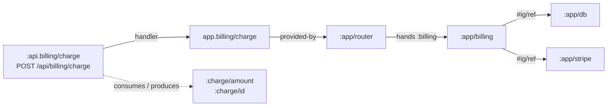

# The pattern: what you write, what you get

DRAFT. A proposal, not what meta-source does today: each section says
which parts exist and which are new.

meta-source today reads whatever a project wrote and does its best: what
it can't read is reported as not read, and a check is as precise as its
heuristics. This document turns that around, the way integrant does. Write
your system in a small, stated shape and meta-source's answers about it are
**exact**, not best-effort. Step outside the shape and meta-source says where,
and what you lose there.

Integrant asks for config as data and one `init-key` per key, and gives
back start order, halt, suspend and resume. The pattern asks for a little
more discipline in the same files and gives back a graph of the system you
can query and write rules over, in the editor, in CI and at startup.

## Levels

Each level needs the one before it. Following one gives its answers for
everything that follows it.

| Level | You write | You get, exactly |
|---|---|---|
| 0 ids | qualified keywords for what the system has: components, routes, functions, data keys | where each is defined, what refers to it, hover |
| 1 edges as data | refs, routes in literal trees, handlers named by var | the system's graph: what depends on what, through config and code |
| 2 contracts | the keys each route, handler and function reads and returns | dataflow: who produces and consumes each key, reads outside a contract |
| 3 facts | aspects and properties in EDN (atlas), on the same ids | rules and queries over meaning: domain, tier, privacy |
| 4 startup | `load!` (atlas) or a snapshot of the router and the system | static and runtime compared: CI and startup check the same thing |

## Off-pattern is a finding

Code meta-source can't read is skipped, with a `:pack-form-not-read` note at
most. A project that adopts the pattern turns on `:pattern true` in a pack's
options, and each rule below that has a check reports `:off-pattern` (info).
It names the rule broken and what is no longer exact because of it:

```
info  src/app/routes.clj:31  route tree built by (into [] ...): routes under it are not in the graph  [:pattern/reitit-literal-tree]
info  src/app/system.clj:12  init-key of :app/api passes its whole config to make-handler: what the handler reaches is everything :app/api refers to  [:pattern/integrant-destructure]
```

A project can then measure how much of it follows the pattern, and know
that every answer meta-source gives about that part is exact.

## Integrant: the well-formed system

| Rule | Shape | What it makes exact | Today |
|---|---|---|---|
| I1 literal config | configs are EDN files, or a def of a literal map; tags only `#ig/ref`, `#ig/refset`, `#ig/var`, `#ig/profile` and readers named in `meta-source.edn` | every component and ref | read; tags kept |
| I2 qualified keys | every top-level key, ref and composite part is a qualified keyword | refs resolvable; integrant throws otherwise | `:ref-invalid` |
| I3 hierarchy as data | `derive` lives in `integrant/hierarchy.edn` (or `duct_hierarchy.edn`), not in code | ambiguous and missing refs through derived keys | read, and code `derive` anywhere, at any depth |
| I4 one builder | each key has an `init-key` on itself or an ancestor, or a fn var named like the key (integrant 0.10's default) | what builds each component | `:no-init-key` |
| I5 destructure | `init-key`'s config parameter is destructured with literal `:keys` (or `{local :ns/key}`), and calls are handed those locals, not the whole map or a rebound value | which components each call is handed: what a route built there reaches | read (`:integrant/passes`); `:off-pattern` when broken |
| I6 no removed methods | no `prep-key`, `pre-init-spec` | | `:removed-method` |
| I7 vars bound | each `#ig/var` is one `bind`, or Duct's `:vars`, provides | startup won't throw `::unbound-vars` | `:var-unbound`, against Duct's `:vars` |

```clojure
;; resources/system.edn
{:app/db     {:url #ig/var db-url}
 :app/users  {:db #ig/ref :app/db}
 :app/billing {:db #ig/ref :app/db :stripe #ig/ref :app/stripe}
 :app/stripe {:key #ig/var stripe-key}
 :app/router {:users #ig/ref :app/users :billing #ig/ref :app/billing}}

;; src/app/system.clj
(defmethod ig/init-key :app/router [_ {:keys [users billing]}]   ; I5
  (app.routes/router users billing))
```

## Reitit: the well-formed router

| Rule | Shape | What it makes exact | Today |
|---|---|---|---|
| R1 literal trees | route trees are literal vectors in a def, a defn's body, or a router call; children are literals or symbols naming route defs | every route and its inherited data | read; `:off-pattern` for code |
| R2 named routes | every route with a handler has a qualified `:name`, which is its id | links (`rfe/href`, `match-by-name`) checked; the route is an entity facts can attach to | read; `:off-pattern` when unnamed |
| R3 handlers by var | `:handler` is a var, or a call building one (`(users/get-user db)`), not an inline `fn` | route → code | read; `:off-pattern` for an inline fn |
| R4 built in a component | the routes fn is called from one `init-key`, handed components by I5 | route → component → everything it refers to | read (`:provided-by`) |
| R5 contracts | `:parameters` and `:responses` name qualified keys (spec or malli) | what each route consumes and produces | read (`:reitit/parameter-keys`, `:reitit/response-keys`) |
| R6 middleware by name | middleware and interceptors are vars or registered keywords, not inline fns | what guards each route, inherited | read |
| R7 policy as data | access rules are route data with qualified keys: `:auth/roles #{:admin}` | rules over who may call what | read (`:reitit/data`) |

```clojure
;; src/app/routes.clj
(defn router [users billing]
  (ring/router
   ["/api" {:middleware [app.mw/wrap-auth]}                      ; R6
    ["/users/:id" {:name :api.users/get                           ; R2
                   :get {:handler (app.users/get-user users)      ; R3, R4
                         :parameters {:path [:map :user/id]}     ; R5
                         :responses {200 {:body [:map :user/email]}}}}]
    ["/billing/charge" {:name :api.billing/charge
                        :auth/roles #{:billing-admin}             ; R7
                        :post {:handler (app.billing/charge billing)}}]]))
```

## The join

Following both patterns, one graph runs from a URL to the infrastructure
behind it, every edge read from the files, none guessed:



Through I5, the route reaches `:app/billing` and what it refers to, not
everything `:app/router` holds: `:api.users/get` does not reach Stripe.
Most of this edge set exists today (`:provided-by`, `:reaches`, the
handed-on locals, see [reference.md](reference.md)). The pattern makes it
complete, and says where it isn't.

### Atlas on the same ids

atlas facts attach to the ids the two libraries already have. No second
name, no copy of the route table:

```clojure
;; registry/system.edn
{:api.billing/charge {:atlas/aspects #{:domain/billing :tier/api}}
 :app/billing        {:atlas/aspects #{:domain/billing :tier/service}}
 :app/stripe         {:atlas/aspects #{:tier/foundation :vendor/stripe}
                      :data/privacy :pci}
 :app/db             {:atlas/aspects #{:tier/foundation}}}
```

**New:** under the pattern, the packs could give each entity its atlas
type themselves: a named route is an `:atlas/interface-endpoint`, a
configured key an `:atlas/structure-component`, a handler var an
`:atlas/execution-function`. The `:deps` would be the edges above. Then
`find-by-aspect`, atlas's invariants and its visual explorer work over a
real system with no entries beyond aspects. That is the step that makes the
join interesting: atlas stops being a registry written by hand next to
the code, and becomes a description of the code plus the meaning the code
can't express.

## Checks and queries this gives

Written in the rules language as it is today, unless marked **new**.

Public routes stay off the database (exists, see reference.md):

```clojure
{:rule/public-off-db
 {:doc "No route under /public reaches the database"
  :when {:kind :reitit :matches {:reitit/path "^/public"}}
  :require [{:reaches {:none {:id :app/db}}}]}}
```

What reaches payment data is authenticated and role-guarded:

```clojure
{:rule/pci-guarded
 {:doc "A route reaching PCI data runs wrap-auth and names its roles"
  :when {:kind :reitit :reaches {:some {:= {:data/privacy :pci}}}}
  :require [{:= {:reitit/middleware app.mw/wrap-auth}}
            {:has-in [:reitit/data :auth/roles]}]}}
```

Tiers: a route reaches infrastructure only through a service (`:handed`:
the components its builder hands it, one hop, where `:reaches` is
transitive and `:deps` is only what the entry names):

```clojure
{:rule/api-through-services
 {:doc "An API route's handler is handed services, not foundation components"
  :when {:kind :reitit := {:atlas/aspects :tier/api}}
  :require [{:handed {:none {:= {:atlas/aspects :tier/foundation}}}}]}}
```

Domains don't cross without saying so:

```clojure
{:rule/billing-boundary
 {:doc "Only billing routes reach Stripe"
  :when {:kind :reitit :reaches {:some {:id :app/stripe}}}
  :require [{:= {:atlas/aspects :domain/billing}}]}}
```

Contracts hold end to end (**new** condition, `:reachable-producers`): every
key in a route's `:responses` is produced by something it reaches, or by
its handler's contract.

Lifecycle (exists, as a rule): what `init-key` starts, `halt-key!` stops.

Queries:

| Question | Command | |
|---|---|---|
| What does this route touch? | `meta-source reach :api.billing/charge` | exists |
| Which routes break if `:app/stripe` changes? | `meta-source reached-by :app/stripe` | exists; `:reached-by` in rules too |
| Which endpoints return PII, and who may call them? | `meta-source routes --produces-privacy :pii` | **new**: a route table joined with facts |
| Which components does no route or job reach? | `meta-source unreached --from reitit` | **new** |
| What does this PR change about who reaches what? | `review/` over the reach graph | **new**: reach diffs on sdiff's page |

## Startup: the same answers at runtime

Level 4 closes the gap static reading leaves. A project that runs
`(atlas.source/load! ...)` or a meta-source snapshot at startup checks:

- the router's `r/routes` against the routes read: a route built at
  runtime that the files don't show;
- `ig/init`'s system keys against the components read;
- the rules themselves, run on the live graph, so a deploy refuses what CI
  would have refused.

**New** for reitit and integrant: only Pathom and atlas write snapshots today.

## What it costs

- The no-migration promise holds only up to level 0. Levels 1–2 ask for
  changes to code that works: naming every route, destructuring every
  `init-key`, moving `derive` calls to EDN. Every one is something reitit or
  integrant already supports, nothing new to depend on.
- The pattern pays off in tooling, unless level 4 runs at startup. That,
  and rules a team actually wants (the billing boundary, PCI guarded), are
  the incentive.
- Inference stays. A project not following the pattern gets what it gets
  today, plus findings that say which step would make each answer exact.

## Open questions

- Should `:off-pattern` be its own check per rule, or one check with the
  rule as data, so `meta-source.edn` can opt out of a rule per namespace?
- Should the packs assign atlas types (an atlas dependency in the packs'
  output vocabulary), or should the atlas pack map pack kinds to types?
  The second keeps integrant and reitit packs atlas-free.
- R2 makes unnamed handler routes off-pattern. Is a generated id good enough
  for a route nobody links to?
- Duct: its modules expand into keys and routes the files don't hold. Is
  Duct's own `expand-key` output part of the pattern, read from the
  module's source, or left to the runtime snapshot?

## Next steps

1. Integrant fixes found in review: transitive `derive` in
   `:ref-to-undefined`; invalid refs and keys (I2); `#ig/var` (I7); the
   missing builder (I4); removed methods (I6).
2. `:off-pattern` for I5, R1, R2, R3: the cases that make reach inexact.
3. Reverse reach (`reached-by`) as a command and a rule condition.
4. Pack kinds mapped to atlas types in the atlas pack, and one example app
   with both patterns, atlas aspects and the four rules above in CI.
5. Router and system snapshots.
