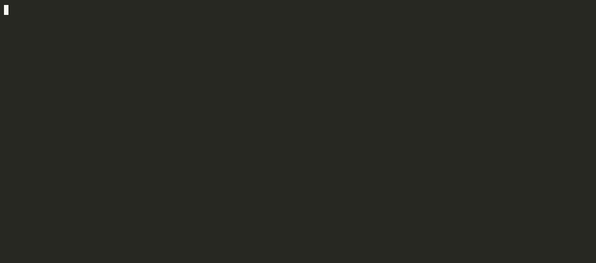

# Reference

The commands, what `check` finds, facts in EDN and the meta key, and the
Emacs package. Packs, and how to write one: [packs.md](packs.md).


## Commands

| | |
|---|---|
| `where <id>` | each file that declares it, its var, its merged entry |
| `uses <id>` | entries that name it, and code that calls its var |
| `deps <id>` | the entities its entry names |
| `data <key>` | a data key's shape, producers and consumers, and the schemas it is a key of |
| `check` | where code and declarations disagree, most severe first |
| `diagnostics <file>` | `check`'s findings in one file, with the line and columns to underline |
| `summary` | counts: entities by source, forms each pack read and couldn't |
| `hover <keyword>` | what an editor shows for a keyword |
| `serve` | long-lived, one JSON request and reply per line: what the editor talks to |

Output is EDN, or JSON with `--json`.

`check` exits 0 whatever it finds. In CI, `--fail-on error` makes it exit 1
when a problem is an error (`warning`: a warning or an error; `info`: any
problem):



## What `check` finds

| Finding | Severity |
|---|---|
| two sources give one key different values (`:conflicting-values`), naming each place | error |
| two vars carry the same meta key value | error |
| an integrant ref no config defines | warning |
| a link to a reitit route name nothing defines; a route handler its namespace doesn't define | warning |
| an aero `#include` not found, a tag with no reader, a `#profile` reading nil, a `#ref` to nothing, a number reader over a non-number | warning |
| an environment variable read with no default that no deployment file sets; a `#profile` branch no profile reads | info |
| a Datascript pull joining or reading in reverse on a non-ref, a lookup ref on a non-unique attribute, an attribute whose spec disagrees | warning |
| a re-frame dispatch or subscription to an id nothing registers | warning |
| one id declared by two packs (a resolver and a component sharing a keyword) | warning |
| code and the running process disagree about an operation | warning |
| a key code uses that isn't in its function's declared contract | info |
| a resolver input nothing produces; an `s/keys` key with no spec; unqualified malli keys | info |
| an `init-key` for a key no config has; a resolver defined but not registered | info |
| a re-frame event never dispatched, a subscription never subscribed to, an effect nothing registers | info |
| a form a pack couldn't read, and why | info |
| one of your own rules, broken (`:rule-violated`), at the rule's severity; a rule not understood | yours; error |

Findings are reported, never guessed around: an option written as code is
reported as not read, rather than read wrongly. Your own invariants are
rules over the same index: [Your own rules](#your-own-rules).

## Facts in EDN, and plain functions

EDN files hold the facts no library has a place for: privacy classes,
ownership, contracts for plain functions. An entry adds to whatever else
describes the same id:

```clojure
;; registry/privacy.edn
{:user/email {:data/privacy :pii}}
```

A plain function says which id it implements with one meta key:

```clojure
(defn ^{:meta-source/id :fn/place-order} place-order [ctx] ...)
```

```clojure
;; registry/functions.edn, in your own words
{:fn/place-order {:fn/reads [:user/id :order/lines]
                  :fn/returns [:order/id :order/total]}}
```

```clojure
;; meta-source.edn: which of your words list data
{:dataflow {:consumes [:fn/reads] :produces [:fn/returns]}}
```

A function with an `s/fdef` or a malli `m/=>` needs neither: the contract it
already has is read, keyed by its var
([docs/packs.md](packs.md#function-contracts-sfdef-and-m)).

A var with the meta key and no entry is valid: an entity with its binding
only, reported as info. `:id-key` in `meta-source.edn` chooses another meta
key; `:merge {key :union}` unions a set-valued key across files instead of
reporting a conflict.

## Your own rules


The packs check what each library means. A project's own invariants are
rules, written as data in EDN files that `:rules` in `meta-source.edn` names:

```clojure
;; meta-source.edn
{:rules ["rules"] ...}

;; rules/shop.edn: rule id → rule
{:rule/pii-readers-audited
 {:doc "Whatever reads a PII key is audited"
  :severity :warning                       ; :error, :warning (the default), :info
  :when {:= {:data/privacy :pii}}          ; the entities it is about
  :require [{:consumers {:all {:has :audit/logged}}}]}

 :rule/components-halt
 {:doc "A component that starts something stops it"
  :when {:kind :integrant :has :integrant/init-key}
  :require [{:has :integrant/halt-key!}]}}
```

A pack can give rules too, derived from what it read (`:pack/rules-of`, see
[packs](packs.md)): atlas's takes the ones a project's invariants carry as
data. They are checked with the project's own.


`:when` selects entities; each `:require` condition must hold on every one of
them. A condition is a map, and every key in it must hold:

| Key | Holds when |
|---|---|
| `:kind :integrant` (or a set) | a source of that kind gives the entity: `:integrant`, `:spec`, `:pathom`, `:re-frame`, `:edn`... |
| `:has :k` (or a vector) | its merged entry has the keys |
| `:missing :k` (or a vector) | it has none of them |
| `:= {:k v}` | its `:k` is `v`, or contains it |
| `:in {:k #{v ...}}` | its `:k` is one of them |
| `:matches {:k "regex"}` | its `:k` is a string the regex finds (`{:reitit/path "^/api/admin"}`) |
| | for `:=`, `:in` and `:matches`, `:k` may be a path: `{:= {[:reitit/data :roles] :admin}}` |
| `:id-ns "shop.admin"` | its id's namespace is that one or under it |
| `:data-key true` | a schema shapes it |
| `:not cond`, `:or [cond ...]` | |
| `:consumers`, `:producers` | a data key's consumers or producers... |
| `:deps`, `:used-by` | ...what its entry names, or what names it... |
| | ...with `{:all cond}`, `{:some cond}` or `{:none cond}` |

Rules see every source at once: a fact from EDN (`:data/privacy`), a pack's
(`:integrant/init-key`), and the relations between them. A violation is a
`:rule-violated` finding at the entity, with the rule's `:doc`, its id and
where it is written (`:rule-at`), the clauses that failed, and for a relation
the entities that broke it. Those are marked in the editor too, where each is
defined. A rule meta-source can't understand (an unknown condition, a
missing `:when`) is an error at the rule, saying why, and so is anything
written after a rules file's map. Rules files are read again when they
change, as registry files are.

## Emacs

```elisp
;; emacs/meta-source.el, anywhere on your load path
(require 'meta-source)
(meta-source-setup)   ; Clojure buffers of projects with a meta-source.edn
```

On any qualified keyword, in code or EDN: eldoc describes it, `M-.` goes to
each place that declares it, `M-?` lists what uses it, `C-c .` opens a
describe buffer. Flymake underlines `check`'s findings where they are. The
package runs the `meta-source` command, or `bb meta-source` from the checkout
it is in. Emacs 27 or later.

