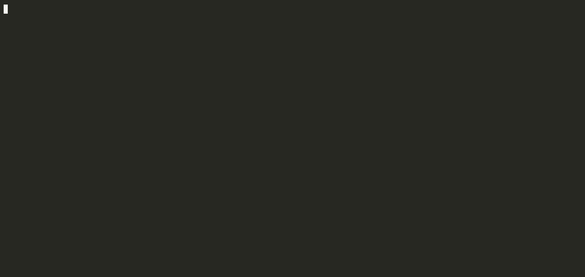

# meta-source review

**What a change does to meta-source's findings**, on the review page of
[sdiff](https://github.com/semantic-namespace/diff).

> **Experimental.** Built on meta-source's and sdiff's experimental interfaces.



On [atlas](https://github.com/semantic-namespace/atlas)'s own example app:
the first commit adds `:item/price` to the subtotal's contract in EDN, which
the `register!` in `cart.clj` also gives, so the two sources now disagree;
the second commit names it in both, and the finding it was meant to fix is
fixed. The tax change reads a key its contract doesn't name.

sdiff shows a change form by form. This module reads the project at the
change's merge base and at its head, runs `meta-source check` on both with
the head's `meta-source.edn`, and compares the findings by what they say, not
where: a finding that only moved lines is neither introduced nor fixed, and a
key added to an existing finding is introduced on its own.

```
derived · meta-source
1 finding introduced · 1 fixed (20 at head)
Introduced
- info src/shop/handlers.clj:7 :user/name is used here but is not in :fn/place-order's contract
Fixed
- info src/shop/spec.clj:10 :user/emial has no spec of its own

■ src/shop/handlers.clj   [semantic]
  defn ^{:meta-source/id :fn/place-order} place-order
    + body › key :order/total › count 3 = (count (:user/name ctx ""))
      derived · meta-source
      introduces
      - info src/shop/handlers.clj:7 :user/name is used here but is not in :fn/place-order's contract
```

The header lists them all; a changed form shows those located inside it,
introduced on its head side, fixed on its base side.

## Dependencies through keywords

sdiff's dependency graph is clj-kondo's: calls between vars. A system wired
by keywords keeps most of its dependencies out of it: a view dispatching a
re-frame event, a resolver whose input another resolver gives, an atlas
function called by its dev-id. This module adds them to the graph, from the
commit's own meta-source index, so a changed form's callers, what it now
depends on, and the risk order count them:

- a form naming an entity's keyword depends on the forms defining it (its
  registration, its `init-key`, its linked var), when the form is in the
  sources `meta-source.edn` names;
- an entry naming another entity (integrant refs, atlas deps), wherever it is
  written, EDN included, makes the first's implementation depend on the
  second's;
- an entity consuming a data key depends on the entities of its own kind that
  produce it (resolver on resolver, atlas function on atlas function), when
  five or fewer do.

On atlas, `calculate-cart-tax`, called by its dev-id, had no callers in
sdiff's graph; it now has its registration, `calculate-cart-total` (which
consumes `:cart/tax`) and three tests. On atlas#52, each invariant that
gained an `:invariant/rule` now shows the entity type it came to depend on:

```
■ core/src/atlas/ontology/system.cljc   [semantic]
  registry/register! :invariant/value-proposition-wired-to-system
    + map 4 › key :invariant/rule = {:doc "A value proposition is delivered by a system" :sev…
      → now :atlas/system, :atlas/value-proposition
```

The graph is read for pull requests (sdiff's dependency analysis needs the
commit), each side with that commit's own `meta-source.edn`, else the
fallback below: a base with neither has no such edges, so its callers can
look gained.

## Use

From this directory, with babashka:

```
bb review text <repo> <base> <head>      # a local range, as `bb sdiff text` prints it
bb review pr <owner/repo#N|url>          # a pull request, with the dependencies above
bb review serve [port] [--host addr]     # sdiff's review UI, default 127.0.0.1:7878
```

`serve` reads pull requests through `gh`, as sdiff does: each side's
Clojure and EDN files are fetched once as a tarball and kept in
`~/.cache/meta-source/review/`. A local range is read with `git archive`.

A repository with no `meta-source.edn` of its own can be given one in
`~/.config/meta-source/review.edn` (`META_SOURCE_REVIEW_CONFIG` names
another file), keyed by `owner/name`:

```clojure
{"acme/shop" {:packs {:integrant {:configs ["resources"]} :spec {}}}}
```

A change that edits `meta-source.edn` is read with the head's on both sides,
so the delta is what the code change does; the page says so.

As a library, in a process that already hosts sdiff (another module's
`use-context!` is kept): `(meta-source.review/install!)`.

## Tests

```
bb test
```

A git repository made from `../test/fixtures/shop` and one commit that fixes
a finding and introduces another, printed through sdiff; the edges the
shop fixture and a small re-frame app add to sdiff's graph.
